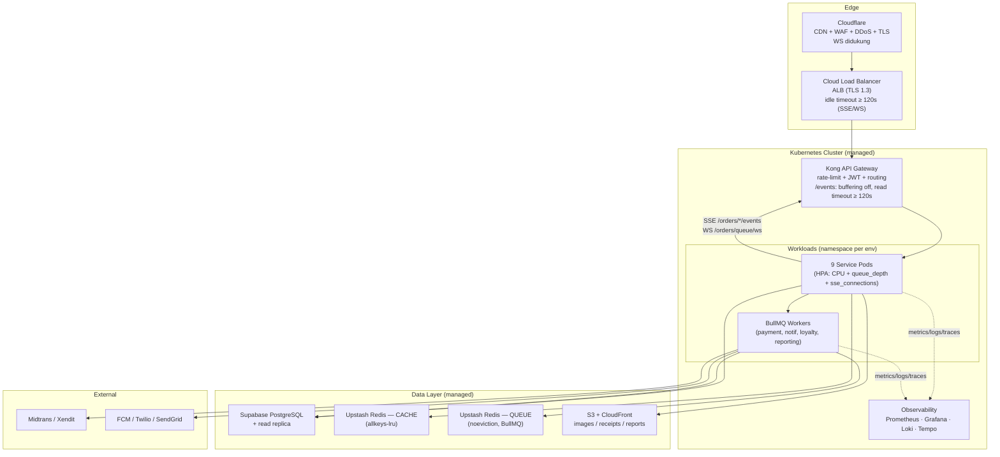
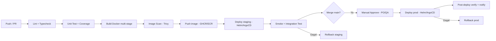

# PRD-BACKEND-DEVOPS — CoffeeShop Online

> **Dokumen Pendukung (SUPPORT) untuk PRD-BACKEND v1.3**  
> Spesifikasi Infrastruktur, CI/CD, Observability & Keamanan Operasional  
> **Versi:** 1.1 | **Tanggal:** 11 Oktober 2026 | **Status:** Draft for PO review  
> **Disusun oleh:** DevOps Engineer Agent | **Atas permintaan:** Product Owner (@kantal)  
> **Changelog v1.1:** sinkron ke PRD-BACKEND **v1.3** — tambah §1.6 SSE, §1.7 Staff WebSocket, §1.8 Fallback Polling, §1.9 Estimasi kapasitas SSE; update traceability (§7) + ADR-009.

---

## 0. Ringkasan & Prinsip

Dokumen ini menerjemahkan kebutuhan fungsional & non-fungsional **PRD-BACKEND v1.3** menjadi desain operasional yang bisa langsung dieksekusi: target infrastruktur MVP, manajemen environment, pipeline CI/CD, observability, keamanan operasional, serta estimasi biaya dan jalur scale-up.

**Konteks yang mengikat desain ini (dari PRD-BACKEND v1.3):**

| Item | Nilai | Sumber |
|------|-------|--------|
| Jumlah service | **9 service/modul** (Auth, Catalog, Order, Payment, Inventory, Loyalty, Reporting, Notification, Admin) | §1 |
| Database | PostgreSQL **single-instance + read replica**, multi-schema | ADR-002 |
| Cache & Queue | **Redis** (cache/session) + **BullMQ** (queue async, *bukan* Kafka) | ADR-003, §7 |
| Inventory deduction | **PostgreSQL trigger** `deduct_inventory_on_order_complete()` (atomic) | ADR-004 |
| Payment | **Midtrans (primary) + Xendit (fallback)** — dual gateway, circuit breaker | §6 |
| **Realtime — pelacakan** | **SSE** `GET /orders/{id}/events` (member), `GET /orders/track/{token}/events` (guest); `text/event-stream`, heartbeat `event: ping` **15s** | **ADR-009**, §2.3 |
| **Realtime — staff** | **WebSocket** `wss://api/orders/queue/ws?outlet_id={outlet_id}` (JWT staff) | **ADR-009**, §2.3 |
| **Realtime — fallback** | Short polling 3s (configurable `/config.tracking_poll_interval_ms`, default 3000) | **ADR-009**, §2.3 |
| **Realtime — latency** | status change → client **< 5s (p95)** | §2.3 |
| SLA | **99.5% uptime** (exclude maintenance 02:00–04:00 WIB) | §7 |
| Backup | **PITR 7 hari** + daily snapshot cross-region | §7 |
| DR | **RPO < 5 menit, RTO < 30 menit** (multi-AZ) | §7 |
| Container | Docker multi-stage → distroless, scan Trivy | §9 |
| Orkestrasi | Kubernetes (EKS/GKE/AKS) atau Docker Swarm untuk MVP | §9 |
| Migrasi DB | Golang-migrate / Flyway / Prisma — versioned | §9 |
| Secrets | External Secrets Operator → AWS Secrets Manager / Vault | §9 |

**Prinsip desain (agar keputusan di dokumen ini konsisten):**

1. **MVP dulu, enterprise kemudian** — pilih managed service & konfigurasi paling ringan yang tetap memenuhi NFR (SLA/PITR/RPO/RTO). Hindari over-engineering sebelum ada trafik.
2. **Stateless service, stateful terkelola** — semua 9 service stateless di container; semua state (PG, Redis, object storage) dikelola provider.
3. **Cloud-portable, bukan cloud-locked** — PG via Supabase, Redis via Upstash, queue via BullMQ (Redis) → pindah cloud murah. Hindari API proprietary untuk jalur data inti.
4. **Observability sejak hari pertama** — correlation-id `x-request-id` (sudah di PRD §7) wajib, bukan tambahan nanti.
5. **Secrets tidak pernah di repo** — ditegaskan PRD §7 & §9.
6. **Koneksi long-lived (SSE/WS) adalah kelas beban tersendiri** — wajib dikonfigurasi eksplisit di **setiap** hop (Cloudflare → ALB → Kong → pod), karena default timeout/buffering di tiap lapisan akan memutusnya (§1.6–§1.9).

**Referensi konteks yang dibaca:** `README.md`, `prd-planning-coffeeshop.md` (§5 Arsitektur Sistem), `diagrams/system-architecture.md`, `PRD-BACKEND.md` (**v1.3**).  
> ⚠️ `tech-stack-recommendation.md` disebut di README tetapi **tidak ditemukan** di folder — dokumen ini menyusun rekomendasi tech-stack operasional secara mandiri. Mohon konfirmasi PO bila file tersebut ada di lokasi lain.

---

## 1. Target Infrastruktur MVP

### 1.1 Peta Komponen & Rekomendasi

| # | Komponen | Rekomendasi MVP | Alternatif | Alasan singkat |
|---|----------|-----------------|------------|----------------|
| 1 | **CDN / WAF** | **Cloudflare (Pro)** | AWS CloudFront + AWS WAF | Edge dekat Indonesia, WAF+DDoS+TLS gratis dalam satu, murah, setup cepat; **mendukung WS/SSE** (jangan aktifkan buffering pada `/events`) |
| 2 | **Load Balancer** | **Cloudflare → cloud LB (ALB / GCP LB)** | NGINX Ingress di cluster | Terminasi TLS + health check; **idle timeout wajib ≥ 120s** agar SSE/WS tidak terputus (default 60s) — lihat §1.6 |
| 3 | **API Gateway** | **Kong Gateway (OSS) di dalam cluster** | AWS API Gateway / Traefik | Routing, rate limiting, validasi JWT, logging — cloud-portable & tanpa biaya per-request; **route `/events`: `proxy_buffering off`, read timeout ≥ 120s** — lihat §1.6 |
| 4 | **Container Runtime** | **Managed Kubernetes** (GKE Autopilot / EKS) | Cloud Run / ECS Fargate / Docker Swarm | 9 service + worker BullMQ + HPA (`queue_depth`, `sse_active_connections`) butuh orkestrasi; managed K8s minim beban ops |
| 5 | **Managed PostgreSQL** | **Supabase (Pro → Team)** ✅ *rekomendasi final* | AWS RDS PostgreSQL Multi-AZ | Lihat §1.3 (decision matrix) |
| 6 | **Redis** | **Upstash Redis** (2 instance terpisah: cache & queue) | AWS ElastiCache (Redis) | Pay-per-request, BullMQ-compatible, tanpa ops; pisah cache vs queue (lihat §1.4) |
| 7 | **Object Storage** | **AWS S3 + CloudFront** | Supabase Storage | Foto produk, struk, export laporan; lifecycle policy ke IA/Glacier |
| 8 | **Message Queue** | **BullMQ di atas Redis** (sesuai ADR-003) | SQS / RabbitMQ (Phase 3) | Sudah diputuskan di PRD; 1 worker pool per domain (payment, notif, loyalty, reporting) |
| 9 | **Realtime transport** | Dijalankan **di dalam Order Service** (long-lived HTTP + WS) | — | SSE untuk pelacakan read-only, WS untuk staff queue; **butuh konfigurasi khusus di ALB/Kong/K8s** — lihat §1.6–§1.9 |

> **Cloud referensi:** **AWS** dipakai sebagai acuan penamaan (ALB/S3/CloudFront/Secrets Manager) karena mayoritas nama service di `system-architecture.md` mengarah ke sana. Padanan GCP/Azure dicatat di kolom alternatif. Komponen kunci (Supabase, Upstash, Kong, BullMQ) bersifat **cloud-agnostic** sehingga keputusan ini tidak mengunci vendor.

### 1.2 Arsitektur Deployment MVP



### 1.3 Keputusan Final: Supabase vs AWS RDS (untuk MVP)

| Kriteria | Supabase (Pro/Team) | AWS RDS PostgreSQL (Multi-AZ) | Pemenang MVP |
|----------|---------------------|-------------------------------|--------------|
| **Time-to-market** | Sangat cepat (PG + Auth + Storage + Realtime 1 dashboard) | Perlu setup VPC, subnet, SG, parameter group | **Supabase** |
| **Biaya awal** | ~$25–$60/bln (Pro/Team) | ~$120–$300/bln (Multi-AZ db.t4g.medium + storage + backup) | **Supabase** |
| **PITR 7 hari** (NFR) | Add-on berbayar (Pro/Team), retensi 7–28 hari | Native, continuous backup, retensi bebas | Seri |
| **Read replica 2x** (NFR) | Add-on (Pro/Team), region terbatas | Native, multi-AZ & cross-region | **RDS** |
| **Multi-AZ / RTO < 30m** (NFR) | HA pada **Team/Enterprise** (Pro = single-AZ) | Multi-AZ native, failover otomatis | **RDS** |
| **PG trigger + pg_trgm + pgcrypto** | Didukung (dipakai ADR-004 & F-001) | Didukung penuh | Seri |
| **Connection pooling** | Supavisor/pgBouncer bawaan (penting: 9 service + worker) | Perlu RDS Proxy | **Supabase** |
| **Kontrol superuser / extension kustom** | Terbatas | Penuh | **RDS** |
| **Kepatuhan (compliance) & audit** | Tergantung tier | AWS-native (SOC2/ISO, CloudTrail) | **RDS** |
| **Ops overhead** | Minimal | Menengah (patching, tuning, proxy) | **Supabase** |

**✅ Rekomendasi Final MVP: Supabase (plan Pro, naik ke Team untuk HA).**

Alasan:
- Menghilangkan pekerjaan Auth/Storage/Realtime dari tim kecil → mempercepat MVP (Phase 1: Bulan 1–2).
- Biaya awal jauh lebih rendah dari RDS setara pada volume MVP.
- Memenuhi kebutuhan inti: ACID, **PG trigger** (ADR-004), **pg_trgm** (F-001), **pgcrypto** (NFR data-at-rest), **PITR 7 hari**, read replica (add-on).
- Connection pooling bawaan penting karena 9 service + worker berbagi satu PostgreSQL.

**Syarat & mitigasi agar NFR tetap terpenuhi di MVP:**
1. **Aktifkan PITR add-on 7 hari** sejak hari pertama (jangan menunggu insiden).
2. **Naik ke plan Team (HA) sebelum go-live produksi** untuk memenuhi **RTO < 30 menit**; selama masa uji internal, single-AZ + PITR dapat diterima dengan risiko terdokumentasi.
3. **Wajib pakai Supavisor/pgBouncer (transaction mode)** — tanpa ini, 9 service × pool akan menghabiskan koneksi PG.
4. Siapkan **runbook restore** & uji restore PITR minimal 1× sebelum go-live.

**Exit criteria → migrasi ke AWS RDS (Phase 3, enterprise):**
- Butuh kontrol superuser / extension kustom, atau logical replication ke data warehouse.
- Koneksi aktif > ~500 atau throughput melewati kapasitas tier Supabase.
- Kebutuhan compliance/audit yang hanya dipenuhi AWS-native.
- Biaya Supabase melampaui RDS setara pada volume yang sama.
- Migrasi: **logical replication** dari Supabase → RDS (downtime minimal), lalu switch connection string via secret manager.

> Ini konsisten dengan `prd-planning-coffeeshop.md` §5.2: *"Supabase untuk MVP/small-medium; AWS RDS PostgreSQL untuk scale-up enterprise."*

### 1.4 Detail Redis (dua instance, jangan digabung)

BullMQ **mensyaratkan** `maxmemory-policy = noeviction` untuk key queue (kalau di-*evict*, job hilang). Sementara cache butuh eviction (`allkeys-lru`). Karena itu:

| Instance | Tujuan | Policy | Catatan |
|----------|--------|--------|---------|
| `redis-cache` | Session, cart guest (`cart:guest:{guestId}` TTL 7d), menu cache TTL 5m, rate-limit counter, **cache status order untuk polling tracking** | `allkeys-lru` | Boleh evict; data bisa diregenerasi |
| `redis-queue` | **BullMQ** (order.paid, notif, loyalty, reporting) + dead-letter | `noeviction` + AOF `everysec` | **Jangan** di-*evict*; aktifkan persistence |

> **Tambahan untuk realtime:** Redis (cache instance) juga dipakai sebagai **pub/sub fan-out** event status order → pod mana pun bisa melayani SSE/WS tanpa sticky session (lihat §1.7). Key publikasi: `orders:outlet:{outlet_id}` dan `orders:status:{order_id}`.

> Alternatif hemat: satu instance Redis dengan **dua logical DB** + kebijakan key prefix — **tetap tidak disarankan** karena `maxmemory-policy` berlaku per-instance, bukan per-DB. Dua instance kecil lebih aman.

### 1.5 API Gateway — kebijakan minimum (dari PRD §7)

- Rate limit: **100 req/min/IP (auth)**, **30 req/min/IP (payment)**.
- Validasi JWT RS256 di gateway; teruskan `sub`, `role`, `outlet_id` ke service.
- Propagasi/generate `x-request-id` (correlation-id) ke semua downstream.
- Payload size limit (mis. 1 MB) & validasi skema dasar (Zod/JSON Schema) — *defense in depth*, tetap divalidasi ulang di service layer.
- **Route realtime (`/orders/*/events`, `/orders/queue/ws`):** dikecualikan dari buffer + pakai timeout khusus — lihat §1.6 & §1.7.

---

### 1.6 SSE (Long-Lived HTTP) — Konfigurasi Infrastruktur

**Endpoint (PRD §2.3, ADR-009):** `GET /orders/{id}/events` (member, JWT) & `GET /orders/track/{token}/events` (guest, public). `Content-Type: text/event-stream`; event `status_change` → `{ status, estimated_ready_time, timestamp }`; heartbeat `event: ping` tiap **15s**; 1 SSE per `order_id` per tab.

**Masalah inti:** SSE = satu HTTP response yang **terbuka lama**. Setiap hop punya default idle-timeout & buffering yang akan memutusnya atau menahan event. Rantai: **Cloudflare → ALB → Kong → pod**.

| Hop | Default bermasalah | Efek | **Set ke** |
|-----|--------------------|------|-----------|
| **ALB** | idle timeout **60s** | Memutus SSE saat idle window terlampaui | **`idle_timeout` ≥ 120s** (= 8× heartbeat, margin aman) |
| **Kong** | `proxy_read_timeout` 60s, buffering ON | Buffer menahan event (client tidak lihat update), read timeout memutus | Route `/events`: `proxy_read_timeout 120s`, **`proxy_buffering off`**, `response_buffering off`, `proxy_cache off`, `proxy_http_version 1.1` |
| **Cloudflare** | origin/idle timeout ~100s; auto-minify/buffering | Bisa menahan event | Heartbeat 15s < 100s → aman; **matikan** optimasi/minify & buffering untuk `/events` |
| **Pod (app)** | gzip/proxy buffering, `ulimit -n` | Event tertahan / kehabisan fd | Kirim header **`X-Accel-Buffering: no`**, matikan gzip untuk `text/event-stream`, naikkan `ulimit -n` |

**K8s / lifecycle:**
- **`terminationGracePeriodSeconds: 60`** (≥ graceful-shutdown timeout) — agar SSE tidak terputus paksa saat rolling deploy.
- **preStop hook**: `sleep 10` (biarkan endpoint hilang dari Service/LB) **lalu** kirim SIGTERM; app menutup stream dengan event penutup + hint `retry:` (mis. 3000ms) supaya klien reconnect terkendali.
- **Connection concurrency per pod**: tetapkan batas eksplisit **`SSE_MAX_CONNECTIONS_PER_POD`**; tolak (HTTP 503) di atas batas → cegah OOM & jaga kualitas.
- **HPA metric tambahan**: custom metric **`sse_active_connections`** (via prometheus-adapter), target mis. **400/pod**, di samping CPU & `queue_depth`.

**Konfigurasi kunci (ringkas):**

```yaml
# Kong route /events (indikatif)
routes:
  - name: order-events
    paths: ["/orders/.*/events$", "/orders/track/.*/events$"]
    protocols: [http, https]
    # plugin / upstream
#   proxy_read_timeout: 120s
#   proxy_send_timeout: 120s
#   proxy_buffering: off
#   response_buffering: off
#   proxy_cache: off
#   proxy_http_version: "1.1"
```

```yaml
# K8s Deployment — Order service (potongan)
spec:
  template:
    spec:
      terminationGracePeriodSeconds: 60
      containers:
        - name: order-service
          lifecycle:
            preStop:
              exec: { command: ["sh","-c","sleep 10"] }
          env:
            - { name: SSE_HEARTBEAT_INTERVAL_MS, value: "15000" }
            - { name: SSE_MAX_CONNECTIONS_PER_POD, value: "600" }
            - { name: GRACEFUL_SHUTDOWN_TIMEOUT_MS, value: "60000" }
```

### 1.7 Staff WebSocket — Konfigurasi Infrastruktur

**Endpoint (PRD §2.3, ADR-009):** `wss://api/orders/queue/ws?outlet_id={outlet_id}` (JWT staff) — broadcast real-time antrian baru & update status.

- **Upgrade HTTP/1.1 wajib**: header `Connection: Upgrade` + `Upgrade: websocket`. Pastikan tiap hop **tidak** men-strip header upgrade.
- **ALB**: mendukung WS native; set **idle timeout ≥ 120s** (WS pakai ping/pong keepalive; jangan biarkan idle memutus).
- **Kong**: route WS pakai `protocols: [http, https]` (Kong meneruskan header Upgrade secara default); **`proxy_buffering off`**; timeout ≥ 120s.
- **Cloudflare**: WS didukung di semua plan — tidak perlu konfigurasi khusus.
- **Fan-out tanpa sticky session**: gunakan **Redis pub/sub** (`orders:outlet:{outlet_id}`) → pod mana pun dapat melayani koneksi; **tidak butuh sticky session** di ALB.
- **K8s**: sama seperti SSE — `terminationGracePeriodSeconds` + preStop drain; batas **`WS_MAX_CONNECTIONS_PER_POD`**.
- **Env (config, bukan secret):** `WS_BASE_URL=wss://api.coffeeshop.example`, `WS_MAX_CONNECTIONS_PER_POD=200`.

### 1.8 Fallback Polling — Dampak & Rate Limit

**Endpoint (PRD §2.3):** `GET /orders/{id}/tracking` (member) & `GET /orders/track/{token}` (guest); interval dari `/config.tracking_poll_interval_ms` (**default 3000ms**).

**Dampak beban saat SSE gagal:**
- Jika 1.000 klien jatuh ke polling 3s → **≈ 333 req/s** ke API Gateway.
- Angka ini masih di bawah burst **1.000 req/s** (PRD §7), tetapi menambah beban **read** ke backend.
- **Mitigasi**: layani tracking dari **Redis cache** (status order di-cache), bukan query PG langsung → 333 req/s jadi cache-hit, bukan beban DB.

**Rate limit & proteksi:**
- **Kong**: rate limit khusus endpoint tracking, mis. **40 req/min/IP** (≈ 1 request / 1.5s) — cukup untuk polling 3s, mencegah flood.
- **Cloudflare**: rate-limiting rule pada path `/orders/*/tracking` & `/orders/track/*`.
- **Client** (catatan untuk FE): tambahkan **jitter + exponential backoff** saat SSE/polling gagal, dan cap interval maksimum.
- **Alert**: jika RPS endpoint tracking melonjak > ambang → indikasi **SSE sedang down**, eskalasi ke on-call.

### 1.9 Estimasi Kapasitas SSE (MVP) & Dampak

**Target MVP: 1.000 koneksi SSE simultan** + koneksi WS staff (kecil, < 50/outlet).

**Analisis:**
- Node.js async SSE: 1 koneksi idle ≈ **20–50 KB** RAM → 1.000 koneksi ≈ **20–50 MB** → **bukan** bottleneck memori.
- **Bottleneck nyata:** file descriptor (`ulimit -n`), jumlah koneksi per target di ALB, worker Kong, dan CPU saat fan-out event.
- **Rekomendasi sizing:** **min 2 pod Order service**, masing-masing mampu **600 SSE** (total **1.200**, headroom **1,2×**); HPA custom metric `sse_active_connections` target **400/pod**, `maxReplicas: 6`.
- **Beban realistis:** concurrency ≈ jumlah order yang di-track simultan. Peak (makan siang/sore) mis. 200–500 → target 1.000 memberi **~2× headroom**.
- **Bandwidth:** heartbeat 15s ≈ 4 event/menit/koneksi; payload ping ~100 B → 1.000 koneksi ≈ **~7 KB/s** total heartbeat. **Tidak signifikan** ke egress/biaya.
- **Catatan rantai koneksi:** 1 SSE = 1 TCP end-to-end (Cloudflare → ALB → Kong → pod). Pastikan Kong worker & `ulimit` pod diset untuk ≥ 600, dan ALB target group tidak punya connection cap rendah (aktifkan **connection draining**).

**Dampak biaya:** minimal — SSE **tidak** menambah biaya infrastruktur berarti (bandwidth kecil); yang bertambah hanya sedikit memory headroom pod & kemungkinan ALB LCU. Estimasi total tetap dalam rentang §6.1 (**≈ $260–520/bln**).

---

## 2. Environment: dev / staging / prod

### 2.1 Pemisahan Environment

| Aspek | `dev` | `staging` | `prod` |
|-------|-------|-----------|--------|
| Tujuan | Developer lokal & preview | Pra-rilis, UAT, QA | Live customer |
| Trigger deploy | Push ke branch fitur | Merge ke `main` (otomatis) | Manual promote (approval PO/QA) |
| K8s | Cluster dev (1 namespace) atau Docker Compose lokal | Namespace `staging` di cluster | Namespace `prod` (cluster terpisah dari dev/staging) |
| PostgreSQL | Supabase project `coffeeshop-dev` | Supabase project `coffeeshop-staging` | Supabase project `coffeeshop-prod` (**Team/HA**) |
| Redis | Upstash dev | Upstash staging | Upstash prod (2 instance) |
| Object Storage | bucket `cs-dev-*` | bucket `cs-staging-*` | bucket `cs-prod-*` |
| Payment | **Midtrans/Xendit Sandbox** | Sandbox | **Live keys** |
| Data | Dummy | Anonimisasi subset prod | Real |
| Secret store | Secrets Manager path `/dev/*` | `/staging/*` | `/prod/*` |
| Observability | Shared (low retention) | Shared (14 hari) | Dedicated (30–90 hari) |

**Aturan:** dev & staging **tidak boleh** menyentuh data atau payment live. Tiap environment punya kredensial, bucket, dan DB **terpisah total** — tidak ada "prod read access" dari staging.

### 2.2 Konfigurasi Secrets

- **Sumber tunggal:** AWS Secrets Manager (atau HashiCorp Vault / Doppler).
- **Distribusi ke pod:** **External Secrets Operator (ESO)** — sinkron ke K8s `Secret` otomatis (sesuai PRD §9).
- **Aturan keras:**
  - ❌ Tidak ada secret di repo, image, atau file `.env` yang di-commit.
  - ❌ Tidak ada secret di ConfigMap / plain env di manifest.
  - ✅ Semua secret di-mount sebagai env dari K8s Secret hasil ESO.
  - ✅ Rotasi berkala (lihat §5.4).
- **Klasifikasi secret vs config:**
  - **Secret (ESO):** `DATABASE_URL`, `REDIS_URL`, `JWT_PRIVATE_KEY`, `MIDTRANS_SERVER_KEY`, `XENDIT_SECRET_KEY`, `FCM_CREDENTIALS`, `TWILIO_AUTH_TOKEN`, `SENDGRID_API_KEY`, `SUPABASE_SERVICE_ROLE_KEY`, `S3_ACCESS_KEY`.
  - **Config (ConfigMap):** `NODE_ENV`, `LOG_LEVEL`, `API_BASE_URL`, `WS_BASE_URL`, `FEATURE_FLAGS`, `TAX_RATE`, `SSE_HEARTBEAT_INTERVAL_MS`, `TRACKING_POLL_INTERVAL_MS`, dll (nilai non-rahasia).

### 2.3 Variabel Environment (per kelompok)

**Umum (semua service):**
```dotenv
NODE_ENV=production            # dev|staging|production
LOG_LEVEL=info                 # debug|info|warn|error
PORT=3000
SERVICE_NAME=order-service
OTEL_EXPORTER_OTLP_ENDPOINT=http://tempo:4318
OTEL_SERVICE_NAME=order-service
```

**Database & cache/queue (secret):**
```dotenv
DATABASE_URL=postgres://…@…supabase.com:6543/postgres   # pakai pooler (Supavisor), port transaction mode
DATABASE_REPLICA_URL=postgres://…                       # read replica (Reporting/Catalog heavy query)
REDIS_CACHE_URL=rediss://…@…upstash.io:6379             # cache (+ pub/sub fan-out realtime)
REDIS_QUEUE_URL=rediss://…@…upstash.io:6379             # BullMQ (noeviction)
```

**Realtime — Order service (config):**
```dotenv
SSE_HEARTBEAT_INTERVAL_MS=15000       # event: ping tiap 15s (PRD §2.3)
SSE_MAX_CONNECTIONS_PER_POD=600       # batas koneksi SSE per pod (lihat §1.9)
WS_MAX_CONNECTIONS_PER_POD=200        # staff queue WS
WS_BASE_URL=wss://api.coffeeshop.example
TRACKING_POLL_INTERVAL_MS=3000        # default /config.tracking_poll_interval_ms
GRACEFUL_SHUTDOWN_TIMEOUT_MS=60000    # drain SSE/WS saat SIGTERM (<= terminationGracePeriodSeconds)
```

**Auth service:**
```dotenv
JWT_PRIVATE_KEY=…              # RS256
JWT_PUBLIC_KEY=…
ACCESS_TOKEN_TTL=15m
REFRESH_TOKEN_TTL=7d
```

**Payment service:**
```dotenv
MIDTRANS_SERVER_KEY=…
MIDTRANS_CLIENT_KEY=…
MIDTRANS_IS_PRODUCTION=true
XENDIT_SECRET_KEY=…
PAYMENT_FAILOVER_ERROR_RATE_THRESHOLD=0.05   # circuit breaker > 5% (PRD §6)
```

**Notification service:**
```dotenv
FCM_SERVICE_ACCOUNT_JSON=…     # atau path ke secret
TWILIO_ACCOUNT_SID=…
TWILIO_AUTH_TOKEN=…
SENDGRID_API_KEY=…
```

**Object storage / CDN:**
```dotenv
S3_BUCKET=cs-prod-assets
S3_REGION=ap-southeast-1
CDN_BASE_URL=https://cdn.coffeeshop.example
```

> **Catatan penting:** `DATABASE_URL` **wajib** memakai port pooler (Supabase Supavisor, `6543` transaction mode), bukan port direct (`5432`). Service **wajib** memakai connection pooling agar 9 service + worker tidak menghabiskan koneksi.

---

## 3. CI/CD Pipeline

### 3.1 Alur (GitHub Actions + Helm/ArgoCD)



### 3.2 Tahapan Detail

| Tahap | Tool | Gagal → aksi |
|-------|------|--------------|
| **Lint & typecheck** | ESLint / TypeScript / golangci-lint | Block merge |
| **Test** | Jest/Vitest (unit) + integration (Testcontainers) | Block merge |
| **Build** | Docker **multi-stage** (builder → **distroless**) sesuai PRD §9 | Block |
| **Scan** | **Trivy** (image + dependency) — fail on `CRITICAL` | Block |
| **Push** | GHCR / AWS ECR, tag `git-sha` + `semver` | — |
| **Migrate** | **Golang-migrate / Flyway** sebagai **initContainer** atau K8s `Job` (versioned, PRD §9) | **Block deploy** — migrasi gagal ⇒ jangan lanjut |
| **Deploy staging** | Helm (GitOps via ArgoCD) | Auto-rollback |
| **Smoke test** | Cek `/health`, `/config`, 1 order sintetis, **1 SSE `/events` + 1 WS connect** | Auto-rollback |
| **Promote prod** | **Manual approval** (PO/QA) | — |
| **Deploy prod** | **Canary / rolling** (Argo Rollouts: 10% → 50% → 100%) | Auto-rollback |
| **Verify** | Cek error-rate, p95 latency, queue depth, **SSE/WS drop rate** pasca-deploy | Auto-rollback |

### 3.3 Strategi Migrasi Database (aman)

1. Migrasi **backward-compatible** dulu (tambah kolom/indeks), jangan drop/rename di rilis yang sama.
2. Migrasi dijalankan **sebelum** rollout pod baru (Job/initContainer) — versi schema harus kompatibel dengan versi lama **dan** baru (expand → migrate → contract).
3. **Advisory lock** (golang-migrate/Flyway) mencegah dua runner berebut.
4. Migrasi berat (indeks pada tabel besar) dijalankan dengan `CREATE INDEX CONCURRENTLY`.
5. **Selalu** ambil snapshot / pastikan PITR aktif sebelum migrasi produksi.

### 3.4 Strategi Rollback

| Skenario | Aksi |
|----------|------|
| Pod baru crash / health gagal | `helm rollback` / Argo Rollouts auto-abort → versi sebelumnya |
| Bug logika (tanpa perubahan schema) | Rollback image ke tag sebelumnya (≤ 1 menit) |
| Perubahan schema | **Tidak** rollback schema otomatis. Karena migrasi expand/contract, versi lama tetap jalan → cukup rollback app; kontrak schema di rilis berikutnya |
| Data korup | Restore **PITR** ke titik sebelum insiden (lihat runbook §5.2) |
| Queue macet | Drain/dead-letter → replay setelah fix |
| **Rolling deploy memutus SSE/WS** | **`terminationGracePeriodSeconds ≥ 60s` + preStop drain** (pod menutup stream rapi, kirim `retry:`); klien reconnect dengan backoff — lihat §1.6/§1.7 |

> **Prinsip:** *rollback app cepat, rollback data hati-hati.* Selalu expand → migrate → contract agar app bisa di-rollback tanpa menyentuh DB.

### 3.5 Quality Gate MVP

- Coverage minimum (mis. 70%) untuk service kritikal (Order, Payment).
- Tidak ada secret terdeteksi (gitleaks di pre-commit & CI).
- Trivy: 0 `CRITICAL`, `HIGH` harus punya justifikasi.
- Contract test antar-service (order ↔ payment ↔ inventory) lulus di staging.
- **Realtime smoke test**: SSE `/events` menerima `ping` + `status_change` < 5s; WS queue terhubung & menerima broadcast; **graceful shutdown tidak memutus** stream saat rolling (uji drain).

---

## 4. Observability

Selaras PRD §7 (Logging JSON, Prometheus+Grafana, OpenTelemetry, Alerting).

### 4.1 Logging

- **Format:** structured **JSON** via `pino` (Node) / `zap` (Go).
- **Wajib ada di tiap log:** `timestamp`, `level`, `service`, **`x-request-id` (correlation-id)**, `user_id?`, `outlet_id?`, `route`, `latency_ms`, `status`.
- **Pipeline:** stdout → Fluent Bit / Promtail → **Grafana Loki** (alternatif: ELK).
- **Retensi:** dev 3 hari · staging 14 hari · prod 30–90 hari.
- **Aturan:** **jangan** log PII (nomor kartu, token, password) atau payload payment mentah.
- **Realtime:** log koneksi SSE/WS pada level `info` saat open/close (dengan `connection_id`, `duration`), jangan log tiap heartbeat.

### 4.2 Metrics (Prometheus + Grafana)

| Kategori | Metric kunci |
|----------|--------------|
| HTTP | `http_request_duration_seconds` (p50/p95/p99), `http_requests_total{status}` |
| Error | `http_errors_total` → **error rate** |
| Queue | `bullmq_queue_depth`, `bullmq_jobs_failed_total`, `bullmq_job_duration_seconds` |
| DB | `pg_pool_active`, `pg_pool_waiting`, `pg_query_duration_seconds` |
| Cache | `redis_hit_ratio`, `redis_memory_used` |
| **Realtime** | **`sse_active_connections`**, `sse_connections_total`, `sse_reconnect_total`, `sse_event_delivery_seconds`, **`ws_active_connections`**, `ws_connections_total` |
| **Polling** | `tracking_poll_requests_total` (proxy untuk mendeteksi SSE down) |
| Business | `orders_created_total`, `payments_success_total`, `payments_failed_total`, `inventory_low_stock_total` |
| Infra | CPU/mem pod, restart count, HPA replicas |

### 4.3 Tracing (OpenTelemetry → Tempo/Jaeger)

- Instrumentasi **OTel SDK** di semua 9 service + worker.
- Propagasi trace context via header `traceparent` + `x-request-id`.
- Trace kunci end-to-end: **checkout → payment initiate → webhook → queue → notification → inventory** (mengikuti alur PRD §4).
- **Realtime:** trace *span* koneksi SSE/WS (bukan tiap heartbeat) agar tidak membanjiri Tempo.
- Sampling: 100% di staging, 10–20% head-based di prod (naikkan saat insiden).

### 4.4 Alerting (Alertmanager → PagerDuty / Telegram)

Ambang mengikuti PRD §7:

| Alert | Kondisi | Severity |
|-------|---------|----------|
| High error rate | `error rate > 1%` (5 menit) | **P1** |
| Latency | `p95 > 1s` (10 menit) | P2 |
| Queue backlog | `queue_depth > 1000` atau `lag > 5 menit` | **P1** (bisa menahan order/notif) |
| Payment failure | `payments_failed_total` naik > 5% (circuit breaker trip) | **P1** |
| DB | pool waiting > 0 sustained, koneksi > 80% kuota | P2 |
| Disk/storage | `disk > 80%` | P2 |
| Sertifikat TLS | kadaluarsa < 14 hari | P2 |
| Backup/PITR | job backup gagal / PITR nonaktif | **P1** |
| Uptime | SLO 99.5% terancam (error budget burn) | **P1** |
| **SSE saturation** | `sse_active_connections` > 80% kapasitas pod (sustained) | P2 |
| **SSE/WS drop spike** | `sse_reconnect_total` / `ws_connections_total` naik tajam | P2 |
| **Polling fallback aktif** | `tracking_poll_requests_total` melonjak (indikasi SSE down) | P2 |

**Runbook wajib** untuk setiap alert P1 (link ke langkah mitigasi).

---

## 5. Keamanan Operasional

### 5.1 TLS

- **TLS 1.3 everywhere** (PRD §7): Client → Cloudflare → LB → service mesh/ingress.
- Sertifikat: **Cloudflare (edge)** + **ACM/Let's Encrypt (origin)**; auto-renew.
- **mTLS antar-service** (opsional, Phase 2) bila pakai service mesh (Istio/Linkerd).
- **HSTS** aktif, redirect HTTP → HTTPS, TLS minimum 1.2 (target 1.3).
- **WS**: wajib **`wss://`** (TLS) — jangan izinkan `ws://` di produksi.

### 5.2 Backup Harian + Point-in-Time Recovery

| Item | Konfigurasi |
|------|-------------|
| **PITR** | Supabase PITR add-on, **retensi 7 hari** (NFR PRD §7) |
| **Daily snapshot** | Otomatis harian, **cross-region copy** |
| **Retensi snapshot** | 7 hari (daily) + 4 minggu (weekly) + 12 bulan (monthly, cold storage) |
| **Object storage** | Versioning + lifecycle (IA setelah 30 hari, Glacier setelah 90 hari) |
| **Redis** | AOF `everysec` pada instance queue |
| **Uji restore** | **Wajib 1× sebelum go-live**, lalu **bulanan** (game day) |

**Target DR (PRD §7):** **RPO < 5 menit, RTO < 30 menit** — dipenuhi via PITR + Multi-AZ (Supabase Team / RDS Multi-AZ).

**Runbook singkat restore:**
1. Deteksi & tentukan **titik waktu** target (sebelum insiden).
2. Restore PITR ke instance baru (jangan timpa prod).
3. Validasi integritas (row count, cek `daily_sales` vs `orders`).
4. Repoint connection string via secret manager.
5. Verifikasi aplikasi & queue, lalu komunikasikan status.
6. Post-mortem tanpa menyalahkan individu (blameless).

### 5.3 Rate Limiting & Proteksi

- **API Gateway (Kong):** 100 req/min/IP (auth), 30 req/min/IP (payment) — PRD §7.
- **Tracking (fallback polling):** **40 req/min/IP** pada `/orders/*/tracking` & `/orders/track/*` — lihat §1.8.
- **Cloudflare:** WAF managed rules + DDoS protection + bot fight mode; rate-limit rule untuk path tracking.
- **Webhook payment:** verifikasi **signature** (Midtrans/Xendit) + **idempotency** by `transaction_id` (PRD §6) — cegah replay.
- **SSE/WS auth:** SSE member & WS staff wajib **JWT valid**; guest SSE pakai `tracking_token` opaque (32-byte) — cegah enumerasi order.
- **Login/OTP:** rate limit per akun + per IP; lockout sementara setelah percobaan gagal berulang.
- **Circuit breaker** payment: failover Midtrans → Xendit bila error rate > 5% (PRD §6).

### 5.4 Secret Management

- **Store:** AWS Secrets Manager / Vault / Doppler (bukan repo).
- **Delivery:** External Secrets Operator → K8s Secret.
- **Rotasi:** DB credential 90 hari · API key payment 180 hari (atau sesuai kebijakan provider) · JWT key pair 180 hari (rotasi bertahap dengan `kid`).
- **Akses:** least-privilege per service (service A tidak bisa baca secret service B).
- **Audit:** aktifkan audit log akses secret; alert bila ada akses anomali.
- **Jangan pernah** menaruh secret di log, error message, atau trace.

### 5.5 Keamanan Supply Chain & Runtime

- **Image:** distroless, non-root, read-only rootfs; **Trivy** scan di CI (fail on CRITICAL).
- **Dependency:** `npm audit`/Dependabot, lockfile pinned.
- **K8s:** NetworkPolicy (default deny), PodSecurity admission (restricted), RBAC least-privilege, resource limits wajib.
- **Payment scope:** data kartu **tidak** disimpan (PCI-DSS via gateway, PRD §7); **card tokenisasi = Phase 2** (PRD §2.4).

---

## 6. Skalabilitas & Biaya

### 6.1 Estimasi Biaya Awal — Tier MVP (kasar)

> Asumsi: 1 outlet, trafik MVP (< ~10 req/s rata-rata, burst saat promo), tim kecil, **1.000 koneksi SSE** (§1.9). **Angka indikatif USD/bulan — perlu diverifikasi ulang terhadap harga provider terkini.**

| Komponen | Tier | Estimasi/bln |
|----------|------|--------------|
| Supabase (Pro + PITR add-on) | Pro | ~$25 + ~$100 (PITR) |
| Upstash Redis ×2 (cache + queue) | Pay-per-request | ~$10–30 |
| Managed K8s (GKE Autopilot / EKS) | Kecil (≥ 2 pod Order untuk SSE) | ~$80–220 |
| Cloud LB (ALB) | 1 (+ LCU SSE) | ~$20–30 |
| Cloudflare (Pro) | 1 domain | ~$20 (atau $0 Free) |
| Object Storage (S3) + CDN | < 100 GB | ~$5–15 |
| Secrets Manager | < 10 secret | ~$5 |
| Observability (Grafana Cloud / self-host) | Free–Pro | ~$0–50 |
| Egress & misc | — | ~$20 |
| **Total estimasi MVP** | | **≈ $260–520/bln** |

**Belum termasuk:** biaya transaksi payment gateway (Midtrans/Xendit — % per transaksi), WhatsApp/SMS (Twilio — per pesan), dan Apple/Google developer account.

> **Dampak realtime ke biaya:** **minimal** — SSE hemat bandwidth (§1.9); kenaikan utama hanya sedikit memory headroom pod & LCU ALB (sudah tercermin di baris di atas).

**Catatan:** Naik ke **Supabase Team** (HA) menambah ~$400/bln. **Wajib** sebelum go-live produksi untuk memenuhi RTO < 30 menit.

### 6.2 Strategi Scale-Up Enterprise

| Dimensi | MVP | Enterprise (Phase 3) |
|---------|-----|----------------------|
| Database | Supabase Pro/Team, 1 read replica | **AWS RDS PostgreSQL Multi-AZ** + 2+ read replica, partitioning |
| Cache/Queue | Upstash Redis ×2 | **ElastiCache Redis Cluster** (sharding) |
| Message Queue | BullMQ (Redis) | **Kafka / AWS SQS+SNS** untuk > 10k msg/s |
| **Realtime** | SSE/WS di Order Service + Redis pub/sub, **1k concurrent** | Dedicated realtime gateway (Redis Cluster pub/sub atau managed pub/sub), **10k+ concurrent**, geo-distributed |
| Compute | Managed K8s, HPA CPU+`queue_depth`+`sse_connections` | Multi-region K8s, cluster autoscaler (Karpenter), node pools terpisah per workload |
| CDN | Cloudflare | Cloudflare Enterprise / multi-CDN |
| Observability | Grafana/Loki/Tempo (retensi 30–90h) | Dedicated stack, long-term storage, SLO/error-budget otomatis |
| Data warehouse | — | Logical replication → ClickHouse/BigQuery untuk analytics (TSDB di `system-architecture.md`) |
| DR | PITR 7 hari, RTO<30m | **Multi-region active-passive**, RPO≈0, RTO<15m, chaos testing |
| Keamanan | WAF, RBAC, ESO | SOC2/ISO, mTLS mesh, SIEM, pen-test rutin |
| Estimasi biaya | ≈ $260–520/bln | ≈ **$1.5k–5k+/bln** (tergantung volume & region) |

**Prinsip scale-up:** naikkan kapasitas **hanya setelah metrik menuntut** (`queue_depth`, p95 latency, DB pool waiting, `sse_active_connections`, biaya per order). Jangan pre-scale sebelum ada data.

### 6.3 Sinyal Kapan Harus Scale

- `queue_depth` konsisten > 1000 → tambah worker / naikkan Redis queue tier.
- `p95 latency` Catalog GET > 500 ms → tambah read replica / perbesar cache hit ratio.
- `pg_pool_waiting` > 0 sustained → naikkan pooler / pertimbangkan RDS Proxy.
- **`sse_active_connections` mendekati kapasitas pod** (> 80% target HPA) → tambah replica Order service / naikkan `SSE_MAX_CONNECTIONS_PER_POD`.
- **`tracking_poll_requests_total` tinggi** → SSE bermasalah; cek timeout ALB/Kong sebelum menambah kapasitas.
- DB storage > 70% → partisi tabel besar (`orders`, `inventory_logs`) atau arsipkan ke S3.
- Biaya bulanan per 1.000 order naik → evaluasi arsitektur (migrasi RDS/Kafka).

---

## 7. Traceability — PRD-BACKEND **v1.3** → Dokumen Ini

| NFR / Keputusan PRD (v1.3) | Dipenuhi di |
|----------------------------|-------------|
| 9 service stateless | §1.1 (#4), §1.2 |
| ADR-002: PG single-instance + read replica | §1.3, §6.2 |
| ADR-003: Redis + BullMQ (bukan Kafka) | §1.1 (#6,#8), §1.4 |
| ADR-004: trigger inventory (atomic) | §1.3 (dukungan PG trigger) |
| **ADR-009: Realtime SSE (primary) + polling fallback 3s + WS staff** | **§1.6, §1.7, §1.8, §1.9** |
| **SSE `GET /orders/{id}/events` & `/orders/track/{token}/events`, heartbeat 15s** | **§1.6, §2.3** |
| **Staff WS `wss://api/orders/queue/ws?outlet_id=`** | **§1.7, §2.3** |
| **Fallback polling 3s (`/config.tracking_poll_interval_ms`)** | **§1.8, §2.3** |
| **Latency realtime < 5s (p95)** | **§1.9, §4.4 (alert delivery)** |
| Dual payment gateway + circuit breaker | §1.5, §5.3 |
| TLS 1.3 everywhere (incl. `wss://`) | §5.1 |
| JWT RS256 + rotation + Redis revoke list | §2.3, §5.4 |
| Rate limiting 100/30 req-min (+ 40 tracking) | §1.5, §1.8, §5.3 |
| Secrets via ESO → Secrets Manager/Vault | §2.2, §5.4 |
| Logging JSON + `x-request-id` | §4.1 |
| Metrics Prometheus + Grafana | §4.2 (incl. `sse_active_connections`) |
| Tracing OTel → Jaeger/Tempo | §4.3 |
| Alerting (error>1%, p95>1s, queue>1000, disk>80%) | §4.4 (+ alert SSE/polling) |
| SLA 99.5% | §6.2, §4.4 (error budget) |
| PITR 7 hari + daily snapshot | §5.2 |
| RPO < 5m / RTO < 30m (multi-AZ) | §5.2, §6.1 (syarat Team/HA) |
| Docker multi-stage + Trivy | §3.2, §5.5 |
| K8s + HPA (CPU/`queue_depth`/`sse_connections`) | §1.1 (#4), §1.9, §4.2 |
| Migrasi DB versioned (golang-migrate/Flyway) | §3.2, §3.3 |
| Feature flags | §2.2 (config) |
| **Endpoint v1.3 lain (reorder ADR-010, cart/merge ADR-011, cancel ADR-012, address book ADR-013)** | **Tidak mengubah infrastruktur** — berjalan sebagai endpoint REST biasa pada Order/Auth service (tanpa konfigurasi khusus); tercakup oleh pola §1.1–§1.5. |

---

## 8. Risiko & Catatan Operasional

| Risiko | Dampak | Mitigasi |
|--------|--------|----------|
| Supabase single-AZ (Pro) gagal saat produksi | RTO terlampaui | **Wajib naik ke Team/HA sebelum go-live**; PITR aktif sejak awal |
| Kehabisan koneksi PG (9 service + worker) | Error 500 massal | Wajib Supavisor/pgBouncer (transaction mode) + pool size per service |
| Redis queue di-*evict* | Job BullMQ hilang | Instance queue terpisah, `noeviction`, AOF `everysec` |
| Webhook payment di-replay | Double-charge | Verifikasi signature + idempotency `transaction_id` |
| Migrasi DB tidak kompatibel | Rollback app gagal | Pola expand → migrate → contract |
| **ALB/Kong idle timeout memutus SSE** | Pelacakan realtime mati; lonjakan fallback polling | **idle/read timeout ≥ 120s**, heartbeat 15s, `proxy_buffering off` (§1.6) |
| **Rolling deploy memutus SSE/WS** | Reconnect storm, klien kehilangan update | **`terminationGracePeriodSeconds ≥ 60s` + preStop drain**, `retry:` hint, backoff klien (§1.6/§1.7) |
| **Polling fallback membanjiri API** | Gateway/DB overload saat SSE down | Rate limit 40 req/min/IP, cache tracking di Redis, jitter+backoff (§1.8) |
| **Kebocoran/enumerasi via guest tracking token** | Akses status order orang lain | Token opaque 32-byte URL-safe, rate limit, jangan log token (§5.3) |
| Biaya membengkak (egress/observability) | Over budget | Budget alert, retensi log terukur, review biaya bulanan |
| Secret bocor via log/trace | Insiden keamanan | Gitleaks di CI, larangan log PII/secret, audit akses |
| Vendor lock-in Supabase/Upstash | Sulit pindah | Exit criteria terdokumentasi (§1.3), jalur migrasi ke RDS |

**Catatan terbuka untuk PO:**
1. Konfirmasi lokasi `tech-stack-recommendation.md` (tidak ditemukan).
2. Konfirmasi target **cloud provider** (dokumen ini mengasumsikan AWS sebagai referensi; mudah disesuaikan ke GCP/Azure).
3. Konfirmasi **single-outlet vs multi-outlet** sejak MVP (mempengaruhi kapasitas & biaya).
4. Konfirmasi budget bulanan yang disetujui untuk tier MVP.
5. **Konfirmasi target concurrent SSE** — dokumen ini memakai asumsi **1.000** (§1.9); naikkan bila ekspektasi lebih tinggi.

---

## 9. Lampiran

### 9.1 Ringkas Keputusan (TL;DR)

- **PostgreSQL:** **Supabase (Pro → Team)** untuk MVP → migrasi **AWS RDS** di enterprise.
- **Redis:** **Upstash ×2** (cache `allkeys-lru` + queue `noeviction`); cache juga untuk **pub/sub realtime**.
- **Queue:** **BullMQ** (sesuai ADR-003).
- **Compute:** **Managed Kubernetes** + HPA (CPU, `queue_depth`, `sse_active_connections`).
- **Edge:** **Cloudflare** (CDN+WAF) → **ALB** → **Kong** (rate-limit/JWT).
- **Realtime:** **SSE** (pelacakan, heartbeat 15s) + **WS** (staff queue) + **polling 3s** (fallback) — **ALB idle ≥ 120s, Kong `proxy_buffering off`, K8s `terminationGracePeriodSeconds ≥ 60s`, target 1.000 concurrent** (§1.6–§1.9).
- **CI/CD:** GitHub Actions → Helm/ArgoCD; migrasi versioned; **canary + rollback**; smoke test SSE/WS.
- **Observability:** pino/zap → **Loki**; **Prometheus+Grafana**; **OTel → Tempo**; **Alertmanager**.
- **Keamanan:** TLS 1.3 (+ `wss://`), **PITR 7 hari** + snapshot cross-region, rate limit (+40 tracking), **ESO → Secrets Manager**.
- **Biaya MVP:** ≈ **$260–520/bln** (di luar biaya transaksi payment & messaging).

### 9.2 Definisi "Definition of Done" — Operasional MVP

- [ ] Semua 9 service berjalan di K8s dengan health/readiness probe & resource limit.
- [ ] `x-request-id` terpropagasi end-to-end; trace checkout→payment terlihat di Tempo.
- [ ] PITR 7 hari **aktif** & **restore teruji** minimal 1×.
- [ ] Rate limit auth, payment, & tracking aktif di Kong.
- [ ] Tidak ada secret di repo (gitleaks bersih); ESO tersinkron.
- [ ] Pipeline: lint→test→scan→build→migrate→deploy staging→**approval**→prod, dengan rollback teruji.
- [ ] Alert P1 punya runbook + notifikasi ke PagerDuty/Telegram.
- [ ] Dashboard Grafana: latency, error rate, queue depth, DB pool, **koneksi SSE/WS**, business metrics.
- [ ] **SSE `/events` (member & guest) stabil > 5 menit tanpa terputus** (uji lintas ALB/Kong).
- [ ] **WS staff queue terhubung & broadcast < 5s**; fan-out via Redis pub/sub tanpa sticky session.
- [ ] **Rolling deploy tidak memutus SSE/WS** (uji graceful drain).
- [ ] **Fallback polling** berfungsi & rate-limited; cache tracking mencegah beban PG.

---

*Disusun oleh DevOps Engineer Agent sebagai dokumen SUPPORT untuk PRD-BACKEND v1.3 (PO-signed). Siap untuk review PO (@kantal).*  
*Lokasi salinan: `kantal/coffeeshop-plan/PRD-BACKEND-DEVOPS.md`.*
