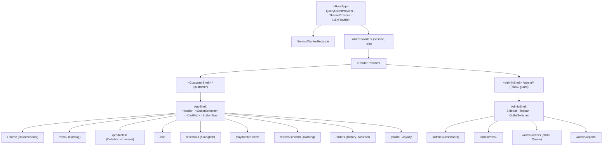

# PRD-FRONTEND — CoffeeShop Online

> **Peran dokumen:** Lead Frontend Engineer
> **Proyek:** CoffeeShop Online — Web App PWA (Customer) + Web Admin (Owner/Manager/Staff)
> **Versi:** 1.3 (tersinkron PRD-BACKEND v1.2/v1.3 — 8 gap FE ditutup PO)
> **Tanggal:** 11 Oktober 2026

## Sumber Referensi
| Dokumen | Lokasi | Peran |
|---|---|---|
| README.md | `coffeeshop-plan/` | Ringkasan proyek & struktur dokumen |
| prd-planning-coffeeshop.md | `coffeeshop-plan/` | Fitur F-001…F-020, persona, acceptance criteria, benchmark UX |
| ux-research-findings.md | `coffeeshop-plan/` | **Tidak ditemukan sebagai file terpisah** — substansinya tersedia pada PRD §3 (benchmark App Store + best practice Baymard/NN-g) dan dipakai di dokumen ini |
| diagrams/system-architecture.md | `coffeeshop-plan/diagrams/` | Client layer, gateway, services, Redis cart, CDN, message queue |
| diagrams/use-case-diagram.md | `coffeeshop-plan/diagrams/` | UC1–UC28 & aktor |
| diagrams/process-flow-diagram.md | `coffeeshop-plan/diagrams/` | Alur order, hitung harga, voucher, loyalty |
| diagrams/class-diagram.md | `coffeeshop-plan/diagrams/` | Model `Cart`, `CartItem`, `Order`, `Voucher`, `LoyaltyPoint` |
| database-design.md | `coffeeshop-plan/` | Skema `carts`, `cart_items`, `orders`, `payments`, `vouchers` (dasar API contract) |

> **Catatan koordinasi:** PRD-FRONTEND ini adalah *consumer* dari API yang dispesifikasikan backend-engineer. §4 sudah **tersinkron dengan PRD-BACKEND v1.2/v1.3** — **semua gap API tertutup** (lihat §4.4).
> ⚠️ `ux-research-findings.md` & `tech-stack-recommendation.md` **tidak ditemukan** sebagai file terpisah di folder `coffeeshop-plan/` (dikonfirmasi juga oleh @backend-engineer & @devops-engineer). Substansi UX diambil dari PRD §3.2–3.3.

---

## 0. Ringkasan & Ruang Lingkup

**Tujuan frontend:** menghadirkan pengalaman pemesanan kopi yang *frictionless* — target **pesan selesai < 90 detik** dan **checkout ≤ 5 langkah dari cart** — pada Web App PWA mobile-first, plus Web Admin operasional untuk Staff/Manager/Owner.

**Ruang lingkup dokumen ini:**
1. Component Tree lengkap (app shell, routing, halaman customer & admin).
2. Strategi State Management khusus **Cart** (global vs server state, persistensi, sinkronisasi lintas tab/device, optimistic update, harga kustomisasi real-time, voucher/poin, merge guest→member).
3. Data fetching & daftar API contract.
4. PWA & performance.
5. Design system & komponen reusable.
6. Accessibility & responsive.
7. Acceptance criteria UX.

**Out of scope:** design visual final (milik UI/UX Designer), implementasi service backend, konfigurasi payment gateway, infrastruktur deploy (milik DevOps).

---

## 1. Tech Stack & Prinsip Arsitektur

| Aspek | Pilihan | Alasan |
|---|---|---|
| Framework | **React 18 + TypeScript + Vite** | Ekosistem PWA matang, TS mencegah bug harga/shape, Vite cepat |
| Routing | **React Router v6** (data router) | Nested routes, lazy routes, `loader`/`action` opsional |
| Server state | **TanStack Query (React Query) v5** | Cache, retry, stale-while-revalidate, optimistic mutation |
| Client/global state | **Zustand** (+ `persist`) | Ringan, tanpa boilerplate, mudah diuji; cart = state klien utama |
| Realtime | **Supabase Realtime** / WebSocket `order.status` | Status order & antrian admin real-time (< 3–5 detik, F-005/F-011) |
| Form & validasi | **React Hook Form + Zod** | Form checkout ringan, validasi skema terbagi dengan backend |
| Styling | **Tailwind CSS + shadcn/ui (Radix primitives)** | Accessible by default, konsisten dengan design token |
| Animasi | **Framer Motion** (selektif) | Bottom sheet, transisi cart badge; tidak di jalur kritis |
| PWA | **vite-plugin-pwa (Workbox)** | Service worker, precache app shell, runtime cache API/gambar |
| Uang | **integer minor unit (Rupiah, tanpa desimal)** | Hindari galat floating point pada harga kustomisasi |
| Testing | Vitest + Testing Library + Playwright | Unit pricing engine, integrasi cart, E2E checkout |

**Prinsip:**
1. **Mobile-first, thumb-friendly** — target sentuh ≥ 44×44 px, aksi utama di sepertiga bawah layar.
2. **Server adalah otoritas** untuk harga, stok, voucher, dan poin. Klien hanya memberi *preview* instan lalu direkonsiliasi.
3. **Guest checkout adalah warga kelas satu** — login tidak pernah menjadi gerbang wajib untuk memesan.
4. **Jalur kritis cepat** — app shell ter-cache, gambar lazy, harga dihitung di klien tanpa round-trip.
5. **Satu sumber kebenaran per data** — jangan duplikasi state server ke store klien kecuali untuk optimistic UX.

---

## 2. Component Tree

### 2.1 App Shell & Routing (High-Level)



**Prinsip shell:**
- **Dua shell terpisah** (`CustomerShell`, `AdminShell`) di-bundle terpisah → pelanggan tidak pernah mengunduh kode admin. Route admin di-*lazy load* dan dilindungi `RoleGuard`.
- **Bottom navigation** (customer) hanya 4 tab: *Home · Menu · Orders · Profile*; Cart diakses lewat **Cart FAB** melayang yang selalu menampilkan badge kuantitas.
- **Auth guard** di level route: `/orders`, `/profile`, `/loyalty` redirect ke login bila belum ada sesi. Order tracking guest memakai route publik terpisah **`/orders/track/:token`** (tanpa login, keputusan (c)).

### 2.2 Peta Route

| Route | Halaman | Akses | Lazy |
|---|---|---|---|
| `/` | Home / Rekomendasi | Public | ✔ |
| `/menu` | Catalog (filter, search) | Public | ✔ |
| `/product/:id` | Product Detail + Kustomisasi | Public | ✔ |
| `/cart` | Cart | Public (guest OK) | ✔ |
| `/checkout` | Checkout (stepper ≤5 langkah) | Public (guest OK) | ✔ |
| `/payment/:orderId` | Payment | Public (guest OK) | ✔ |
| `/orders/track/:token` | Order Tracking (guest, `GET /orders/track/{token}`) | Public — token | ✔ |
| `/orders/:orderId` | Order Detail/Tracking (member, `GET /orders/{id}`) | Member | ✔ |
| `/orders` | Order History + Reorder | Member | ✔ |
| `/profile`, `/profile/loyalty` | Profile & Loyalty | Member | ✔ |
| `/login`, `/register` | Auth | Public | ✔ |
| `/admin`, `/admin/menu`, `/admin/orders`, `/admin/reports` | Admin | RBAC | ✔ |

### 2.3 Component Tree — Customer

**A. Home / Rekomendasi**
```
HomePage
├─ GreetingBar (nama member / "Halo!" untuk guest)
├─ OutletSelectorBanner (outlet terdekat + jam operasional)
├─ OrderAgainRail            ← F-006 reorder 1-klik (dari /orders terakhir)
│   └─ ReorderCard × n
├─ PromoBannerCarousel       ← F-018 voucher aktif
├─ RecommendationSection     ← personalisasi dari riwayat / best seller
│   └─ ProductCard × n
├─ CategoryShortcutGrid
└─ LoyaltyTeaserCard         ← poin & progress tier (member)
```

**B. Menu / Catalog**
```
MenuPage
├─ SearchBar (autocomplete debounce 250ms, F-001)
├─ CategoryTabs (Hot, Cold, Non-Coffee, Food, Merch)
├─ FilterSheet (badge vegan/gluten-free/bestseller; harga)
├─ SortDropdown (populer, harga, baru)
├─ ProductGrid (virtualized bila > 60 item)
│   ├─ ProductCard → ProductCardSkeleton
│   └─ EmptyState / ErrorState
└─ CartFAB (badge qty)
```

**C. Product Detail & Kustomisasi**
```
ProductDetailPage
├─ ProductGallery (foto, CDN responsive, blur placeholder)
├─ ProductHeader (nama, harga dasar, rating, badge)
├─ NutritionAllergenAccordion (opsional, F-001)
├─ CustomizationForm (F-002)
│   ├─ VariantSelector        (Single) — Small/Medium/Large
│   ├─ OptionGroup × n        (Single/Multiple, min/max_select)
│   │   └─ OptionValueChip (label + Δharga + status stok)
│   ├─ ToppingSelector (multi, batas max_select)
│   ├─ NoteField ("Catatan untuk barista")
│   └─ StickyPriceFooter      ← harga real-time + tombol "Tambah · Rp XX.XXX"
└─ RecommendationRail ("Sering dipesan bersama")
```
> **Mobile:** form kustomisasi dirender dalam **BottomSheet** (satu layar, sesuai best practice §3.2 poin 4) dengan `StickyPriceFooter` sebagai aksi utama.

**D. Cart**
```
CartPage
├─ FulfillmentTabs (Dine-in / Takeaway / Pickup / Delivery) ← selector tunggal (F-003)
├─ OutletPickupInfo (alamat, jam, estimasi) — mode Pickup/Dine-in/Takeaway
├─ DeliveryAddressCard (dari AddressBook) — **hanya mode Delivery**; + ongkir/estimasi
├─ CartItemList
│   └─ CartItemRow
│       ├─ ItemThumbnail
│       ├─ ItemMeta (nama, varian, ringkasan opsi, catatan)
│       ├─ QtyStepper (inline, tanpa tombol "Apply")
│       ├─ PriceBreakdown (unit_price × qty = subtotal)
│       └─ SwipeToDelete / RemoveButton
├─ VoucherInput ("Punya kode promo?")
├─ PointsRedeemer (slider poin, tampil saldo & konversi)
├─ CartSummary (Subtotal, Diskon, Pajak, Biaya kirim*, **Grand Total**)  *baris ongkir hanya mode Delivery
├─ EmptyCartState
└─ CheckoutCTA (sticky bottom) → /checkout
```

**E. Checkout (≤ 5 langkah)**
```
CheckoutPage
├─ CheckoutStepper (1 Fulfillment → 2 Waktu/Outlet → 3 Kontak → 4 Pembayaran → 5 Konfirmasi)
├─ Step1 FulfillmentStep (Dine-in/Takeaway/Pickup/Delivery; guest di sini)
├─ Step2 ScheduleStep (adaptif: mode Pickup/Dine-in/Takeaway → pilih outlet + ASAP/jadwal; mode **Delivery** → pilih/isi `DeliveryAddressCard` + ongkir. Field alamat hanya muncul untuk Delivery → tetap ≤5 langkah)
├─ Step3 ContactStep
│   ├─ GuestCheckoutButton ← **paling menonjol** (62% situs salah, §3.3)
│   ├─ LoginPrompt ("Sudah punya akun? Masuk")
│   └─ ContactForm (nama, telepon/WhatsApp, email opsional; tandai required/optional)
├─ Step4 PaymentStep (QRIS, e-wallet, VA, kartu, Apple/Google Pay, cash)
├─ Step5 ReviewStep (ringkasan final + syarat)
├─ OrderSummarySidebar (sticky, mobile = collapsible)
└─ PlaceOrderButton ("Buat Pesanan · Rp XX.XXX")
```

**F. Payment**
```
PaymentPage
├─ OrderBrief (nomor order, total, countdown expired)
├─ PaymentMethodDetail (QR / VA number / deep link e-wallet)
├─ CopyToClipboard / OpenWalletDeepLink
├─ PaymentStatusPoller (polling + WebSocket fallback)
├─ ResultStates: Pending · Success · Failed · Expired
└─ RetryPaymentCTA (ganti metode, tanpa membuat order baru)
```

**G. Order Tracking**
```
OrderTrackingPage
├─ OrderStatusTimeline (PENDING→PAID→CONFIRMED→BEING_PREPARED→READY→COMPLETED/CANCELLED)
├─ EtaBadge ("Siap ± 12 menit")
├─ OutletPickupCard (map + alamat)
├─ LiveStatusBanner (SSE `/orders/{id}/events` + fallback polling 3s, <5s)
├─ OrderItemsSummary
├─ NotificationToggle (push/WA)
└─ ReviewPrompt (muncul saat COMPLETED)
```

**H. Order History / Reorder**
```
OrderHistoryPage
├─ FilterChips (status, 12 bulan terakhir)
├─ OrderHistoryList → OrderHistoryCard (Reorder 1-klik)
└─ OrderDetailDrawer
```
> Reorder memuat ulang **semua kustomisasi** (F-006); item yang sudah tidak tersedia ditandai dan user diminta menyesuaikan.

**I. Profile & Loyalty**
```
ProfilePage
├─ ProfileHeader (avatar, nama, tier badge)
├─ LoyaltyCard (poin, progress ke tier berikut, expiry)
├─ RewardCatalog (redeem poin → voucher, F-007)
├─ AddressBook (delivery)
├─ PaymentMethods (saved, opsional)
├─ NotificationSettings
└─ OrderHistoryLink · Logout
```

### 2.4 Component Tree — Admin

```
AdminApp
├─ AdminShell (Sidebar, Topbar, OutletSwitcher, RoleBadge)
├─ AdminDashboard (/admin)
│   ├─ KpiCards (revenue hari ini, orders, avg ticket, low-stock)
│   ├─ SalesChart (7/30 hari)
│   ├─ TopProductsTable
│   └─ LowStockAlertList
├─ MenuManagement (/admin/menu)
│   ├─ MenuTable (search, filter kategori, toggle visibility)
│   ├─ ProductEditorDrawer (CRUD, varian, opsi, BOM, foto)
│   └─ BulkPriceUpdateDialog
├─ OrderQueue (/admin/orders)                 ← F-011
│   ├─ QueueColumns (Baru · Diproses · Siap · Selesai)
│   ├─ OrderTicketCard (nomor, item, timer, channel filter)
│   ├─ StatusActionBar (Confirm / Prepared / Ready / Complete / Cancel+alasan)
│   └─ PrintTicketButton (kitchen ticket)
├─ Reports (/admin/reports)                   ← F-014/F-015/F-017
│   ├─ PeriodOutletFilter
│   ├─ SalesReportTable + ExportButton (Excel/CSV)
│   ├─ ProfitLossSummary
│   └─ TaxSummaryCard
└─ (Phase 2+) Inventory · Vouchers · Staff · Outlets
```

---

## 3. Strategi State Management — Fokus **Cart**

### 3.1 Taksonomi State

| Kategori | Contoh data | Alat | Sumber kebenaran |
|---|---|---|---|
| **Server state** | Katalog produk, detail produk, stok, voucher aktif, order, poin, laporan | **TanStack Query** | Backend (PostgreSQL/Redis) |
| **Client/global state** | Isi cart (guest), fulfillment terpilih, voucher ter-apply (kode), draft kustomisasi, UI (sheet open) | **Zustand** | Klien |
| **URL state** | filter kategori, `?step=2`, `orderId` | React Router search params | URL (shareable) |
| **Form state** | form checkout, alamat | React Hook Form | Komponen |

**Prinsip pemisahan:** cart *line items* yang belum di-checkout adalah **client state** (agar bisa dihitung & diubah tanpa latensi). Setelah login, cart disinkronkan ke **server state** (Redis-backed via API) agar persisten lintas device. Katalog & harga master **selalu** server state — klien tidak menyimpan harga otoritatif, hanya salinan untuk preview.

### 3.2 Bentuk Store Cart (Zustand)

```ts
// money = integer Rupiah (minor unit), TANPA desimal
type Money = number;

interface CartOptionSnapshot { optionValueId: string; name: string; priceAdjustment: Money; qty: number; }
interface CartVariantSnapshot { variantId: string; name: string; priceAdjustment: Money; }

interface CartLine {
  lineId: string;              // uuid lokal, stabil lintas edit
  fingerprint: string;         // dedupe key: productId|variantId|sorted(optionValueIds)|note
  productId: string;
  productName: string;         // snapshot untuk render cepat (bukan otoritatif harga)
  imageUrl: string;
  variant?: CartVariantSnapshot;
  options: CartOptionSnapshot[];
  note?: string;
  quantity: number;
  basePriceSnapshot: Money;    // harga dasar saat ditambahkan (untuk deteksi perubahan)
}

interface CartState {
  // ---- data ----
  cartId: string | null;                 // id cart server (setelah sync), null untuk guest murni
  guestId: string;                       // uuid persisten (session_id) di localStorage
  outletId: string | null;
  fulfillment: 'dine_in' | 'takeaway' | 'pickup' | 'delivery';
  lines: CartLine[];
  appliedVoucher: { code: string; discount: Money; validatedAt: number } | null;
  pointsToRedeem: number;
  // ---- meta ----
  version: number;                       // naik tiap mutasi, untuk konflik LWW
  updatedAt: number;                     // epoch ms
  syncState: 'local' | 'syncing' | 'synced' | 'error';
  // ---- actions ----
  addLine(p: Omit<CartLine,'lineId'|'fingerprint'>): void;
  updateQuantity(lineId: string, qty: number): void;
  removeLine(lineId: string): void;
  setFulfillment(f: CartState['fulfillment']): void;
  applyVoucher(v: CartState['appliedVoucher']): void;
  setPoints(n: number): void;
  clear(): void;
  mergeFromGuest(guestLines: CartLine[]): void;
}
```

**Selector turunan (bukan state):** `selectSubtotal`, `selectDiscount`, `selectTax`, `selectDeliveryFee`, `selectGrandTotal`, `selectItemCount`. Dihitung via fungsi murni agar tidak ada state turunan yang bisa *drift*.

### 3.3 Pricing Engine — Perhitungan Harga Kustomisasi Real-time

Fungsi **murni & deterministik** (dipakai klien untuk preview, dipakai server untuk otoritas):

```ts
// Semua operasi pada integer Rupiah → bebas floating point
function lineUnitPrice(line: CartLine): Money {
  const variant = line.variant?.priceAdjustment ?? 0;
  const options = line.options.reduce((s,o) => s + o.priceAdjustment * o.qty, 0);
  return line.basePriceSnapshot + variant + options;
}
function lineSubtotal(line: CartLine) { return lineUnitPrice(line) * line.quantity; }

function computeTotals(cart: CartState, ctx: PricingContext) {
  const subtotal = cart.lines.reduce((s,l) => s + lineSubtotal(l), 0);
  const discount = cart.appliedVoucher ? computeVoucherDiscount(cart.appliedVoucher, subtotal, ctx) : 0;
  const pointsDiscount = cart.pointsToRedeem * ctx.pointValue;      // mis. 1 poin = Rp 1
  const taxable = Math.max(0, subtotal - discount - pointsDiscount);
  const tax = Math.round(taxable * ctx.taxRate);                    // PPN, dibulatkan sekali
  const deliveryFee = cart.fulfillment === 'delivery' ? ctx.deliveryFee : 0;
  const grandTotal = Math.max(0, taxable + tax + deliveryFee);
  return { subtotal, discount, pointsDiscount, tax, deliveryFee, grandTotal };
}
```

- Dijalankan **sinkron** pada setiap perubahan opsi → `StickyPriceFooter` (PDP) & `CartSummary` (cart) update < 16 ms, tanpa round-trip.
- **`PricingContext` berasal dari `GET /config`** (keputusan (b)): `ctx.taxRate = config.tax_rate`, `ctx.pointValue = config.point_value`, `ctx.deliveryFee = config.shipping_flat_fee`. **Tidak di-hardcode.**
- **Anti-drift:** klien menyimpan `basePriceSnapshot`; saat `GET /orders/cart` atau checkout, server mengembalikan harga terkini; bila berbeda, tampilkan banner *"Harga diperbarui"* dan minta konfirmasi.
- **Kombinasi tidak valid** (mis. oat milk habis) dinonaktifkan di UI dengan pesan jelas (F-002 AC) — validasi berasal dari `optionValue.is_available` pada data katalog.

### 3.4 Persistensi Cart (Keputusan (a): **HYBRID**)

**Keputusan PO (terkunci):** localStorage tetap jadi cache offline/instan, **tetapi** cart juga di-mirror ke server **Redis** keyed `cart:guest:{guestId}` (TTL 7 hari) — bukan lagi localStorage murni.

| Mode | Mekanisme | Detail |
|---|---|---|
| **Guest (belum login)** | `localStorage` (Zustand `persist`) **+ mirror Redis** | Klien generate `guestId` (uuid) → simpan di `cs.guestId`; kirim header **`X-Guest-Id`** di semua request `/orders/cart*`. Redis = **source of truth saat checkout** (lock stok + rekalkulasi harga). TTL Redis 7 hari. |
| **Member (login)** | **Redis/DB-backed** via API (`carts`/`cart_items`) | Cart persist per `customer_id`, tersedia lintas device. `localStorage` tetap cache baca cepat. |

**Peran masing-masing (hybrid):**
- `localStorage` → **instan & offline**: render cart tanpa round-trip, tetap ada saat app ditutup/refresh (AC-04).
- Redis (`X-Guest-Id`) → **otoritas saat checkout**: server mengunci stok & merekalkulasi harga. Bila `localStorage` ≠ Redis, Redis menang dan FE menampilkan *"Harga/isi keranjang diperbarui"*.
- **Sinkron:** setiap mutasi → update store lokal (0 ms) lalu debounce 800 ms push ke `POST/PUT/DELETE /orders/cart/items`. Saat kembali online, flush antrean.

```ts
persist(
  (set,get) => ({ /* ...state */ }),
  {
    name: 'cs.cart.v1',
    version: 1,
    migrate: (persisted, from) => migrateCart(persisted, from), // wajib: skema berubah
    partialize: (s) => ({ lines: s.lines, outletId: s.outletId, fulfillment: s.fulfillment,
                          appliedVoucher: s.appliedVoucher, pointsToRedeem: s.pointsToRedeem,
                          guestId: s.guestId, version: s.version, updatedAt: s.updatedAt }),
  }
)
```
- **`guestId`:** dibuat sekali (`crypto.randomUUID()`), tidak pernah dirotasi kecuali setelah merge sukses.
- **TTL:** Redis guest cart 7 hari (backend). FE: bila `updatedAt` > 7 hari, tandai kadaluarsa → validasi ulang ke server saat dibuka.
- **Kuota:** bila `localStorage` penuh, fallback ke `IndexedDB` (via `idb-keyval`).

### 3.5 Sinkronisasi Lintas Tab & Lintas Device

**Lintas tab (browser yang sama):** `BroadcastChannel('cs-cart')` + listener `storage` sebagai fallback.

```ts
const bc = new BroadcastChannel('cs-cart');
// Setiap mutasi lokal → broadcast ringkas (bukan seluruh state)
store.subscribe((s) => bc.postMessage({ type: 'CART_MUTATED', version: s.version, updatedAt: s.updatedAt, lines: s.lines }));
bc.onmessage = (e) => {
  const s = useCart.getState();
  if (e.data.updatedAt > s.updatedAt) useCart.setState({ lines: e.data.lines, version: e.data.version, updatedAt: e.data.updatedAt });
};
```
→ Buka cart di 2 tab: perubahan kuantitas di tab A langsung tercermin di tab B (badge Cart FAB konsisten).

**Lintas device (member login):**
- Server menyimpan cart per `customer_id`; `version`/`updated_at` jadi penanda konflik.
- Strategi **Last-Write-Wins per line** saat sinkron: line dengan `updated_at` lebih baru menang; line hanya-ada-di-satu-sisi digabung. Server mengembalikan cart kanonik → klien menimpa state lokal.
- Guest di device lain (belum login) memakai `X-Guest-Id` masing-masing → tidak saling mengganggu sampai merge.

### 3.6 Optimistic Update

Semua mutasi cart yang memengaruhi server memakai pola TanStack Query:

```ts
useMutation({
  mutationFn: (payload) => api.putCart(payload),
  onMutate: async (payload) => {
    await qc.cancelQueries({ queryKey: ['cart'] });
    const prev = qc.getQueryData<CartDTO>(['cart']);
    qc.setQueryData(['cart'], optimisticCart(prev, payload));  // UI instan
    return { prev };
  },
  onError: (_e, _p, ctx) => qc.setQueryData(['cart'], ctx.prev), // rollback
  onSettled: () => qc.invalidateQueries({ queryKey: ['cart'] }),
});
```
- **Aksi lokal murni** (tambah/hapus/ubah qty) → update store langsung (0 ms), lalu debounce push ke server.
- **Aksi yang butuh validasi server** (apply voucher, redeem poin, checkout) → optimistic dengan rollback + toast bila gagal.
- Tombol checkout **disabled** selama `syncState === 'syncing'` untuk mencegah order atas cart basi.

### 3.7 Integrasi Voucher & Poin

- **Voucher:** user memasukkan kode → `POST /orders/cart/voucher` `{ voucher_code }` (server) mengembalikan diskon & alasan bila gagal (invalid/expired/min-purchase/tidak berlaku) sesuai logika §6 process-flow. Diskon dihitung klien sebagai preview, tapi **dihitung ulang server** saat `POST /orders/checkout`.
- **Poin:** `GET /loyalty/profile` → saldo; user memilih jumlah poin (slider) → kirim `{ points_to_redeem }` ke `POST /orders/cart/voucher`. Konversi `point_value` dari `GET /config`. Poin & voucher **tidak boleh** melebihi subtotal → `taxable = max(0, ...)`.
- **Konflik aturan:** urutan penerapan **Subtotal → Voucher → Poin → Pajak → Biaya kirim** (konsisten dengan process-flow §3). Bila voucher mengecualikan poin, server menolak dan klien menampilkan pesan.

### 3.8 Guest → Member Cart Merge (Keputusan (a))

Alur (login/register saat cart sudah berisi item). Karena guest cart kini ada di Redis, **server yang menggabungkan** — FE tidak perlu mengirim seluruh lines:

```mermaid
sequenceDiagram
    participant U as User
    participant C as Cart Store (localStorage + guestId)
    participant API as Backend (Redis cart:guest:{guestId} + PG)
    U->>C: Login berhasil (form)
    C->>API: POST /auth/login (header X-Guest-Id)  ← ADR-011 merge otomatis
    API->>API: Union by fingerprint; qty dijumlah (cap max); harga direkonsiliasi
    API-->>C: { access_token, user, cart_merged: true, cart_item_count: N }
    C->>C: refresh ['cart'] → timpa state, rotasi guestId, clear cs.cart guest
    C-->>U: Toast "N item keranjang digabungkan"
    Note over C,API: Fallback (login non-form): POST /orders/cart/merge { guest_id }
```

> **Dua jalur (ADR-011):** (1) **Otomatis** — FE kirim header `X-Guest-Id` saat `POST /auth/login|register`; response `cart_merged` + `cart_item_count` menandakan merge berhasil. (2) **Eksplisit** — `POST /orders/cart/merge { guest_id }` untuk kasus login tanpa form (refresh token / SSO). Keduanya idempotent per `guestId`.

**Aturan merge (disepakati backend — idempotent per `guestId`):**
1. **Kunci dedupe = `fingerprint`** (`product_id|variant_id|sorted(option_value_ids)|note`). Line identik → **jumlahkan kuantitas**, cap pada `max_order_qty`.
2. Line guest yang **produknya sudah tidak tersedia** → ditandai *"tidak tersedia"*, tidak dihapus diam-diam; user memutuskan.
3. **Voucher:** jika member sudah punya voucher ter-apply dan guest juga → **pertahankan voucher member**; voucher guest disimpan sebagai *suggestion* yang harus divalidasi ulang.
4. **Poin:** hanya berlaku untuk member; `points_to_redeem` guest diabaikan.
5. **Harga:** setiap line direkonsiliasi ke harga master terkini; bila berubah, tampilkan ringkasan sebelum checkout.
6. Setelah merge sukses → **hapus cart guest dari localStorage** dan **rotasi `guestId`** untuk sesi berikutnya.
7. **Idempotensi:** `POST /orders/cart/merge` aman di-retry dengan `guest_id` sama (tidak menggandakan). Redis guest cart lama dibiarkan expire (TTL 7d).

### 3.9 Edge Cases & State Machine Ringkas

| Skenario | Perilaku |
|---|---|
| Produk dihapus/nonaktif saat ada di cart | Tandai "tidak tersedia", blokir checkout sampai dihapus |
| Harga berubah sejak ditambahkan | Banner "Harga diperbarui", minta konfirmasi |
| localStorage ≠ Redis (guest) | Redis menang saat checkout; FE tampilkan "isi keranjang diperbarui" |
| Stok varian habis saat checkout | Server tolak → rollback optimistic, tandai line |
| Voucher kadaluarsa saat checkout | Server tolak → hapus apply, hitung ulang total |
| Order timeout pembayaran | `PENDING → CANCELLED` (process-flow §5); tombol "Pesan ulang" |
| Guest cart kedaluwarsa (Redis TTL 7d) | Muat dari localStorage; validasi ulang ke server saat dibuka |
| User refresh di tengah checkout | State step & cart pulih dari localStorage/URL |
| Logout saat cart berisi | Cart tetap lokal + Redis guest; ditawarkan gabung saat login lagi |

---

## 4. Data Fetching & API Contract (Selaras PRD-BACKEND v1.2/v1.3 — 8 gap tertutup)

**Pola:** TanStack Query dengan `queryKey` terstruktur, `staleTime` per domain, retry 2× backoff, dan `mutate` untuk semua write.
**Base URL:** `https://api.coffeeshop.example/api/v1` — path berpola `/{service}/{resource}` (service: `auth`, `catalog`, `orders`, `payments`, `loyalty`, `inventory`, `reports`, `notifications`, `admin`).

### 4.1 Konvensi (dari PRD-BACKEND §2)
- **Response envelope:** `{ "success": true, "data": <T>, "error": null }`; error → `{ "success": false, "error": { "code": "VOUCHER_EXPIRED", "message": "...", "details": {} } }`.
- Format uang: **integer Rupiah** (`total_amount: 45000`). Waktu: ISO-8601 UTC.
- **Auth:** `Authorization: Bearer <access_token>` (JWT RS256, access 15m / refresh 7d + rotation).
- **Guest:** header **`X-Guest-Id: <uuid>`** di semua request cart/checkout sebelum login. Client men-generate uuid sekali dan menyimpannya di localStorage (`cs.guestId`). Backend key Redis = `cart:guest:{guestId}`, **TTL 7 hari**.
- **Paginasi:** `?page=&limit=` (bukan cursor) → response `{ data: T[], meta: { page, limit, total } }`.
- **Idempotency:** `POST /orders/checkout` & `POST /payments/initiate` kirim header `Idempotency-Key` (uuid) untuk mencegah double order/charge saat retry.
- **Correlation:** header `x-request-id` untuk tracing.

### 4.2 Konfigurasi Publik (BARU — keputusan (b))

```ts
// GET /config  → publik, cache 300s (staleTime besar, refetch on focus)
interface AppConfig {
  tax_rate: number;                 // mis. 0.11
  point_value: number;              // nilai 1 poin dalam Rupiah, mis. 1
  currency: 'IDR';
  active_payment_methods: PaymentMethod[];
  shipping_flat_fee: number;        // ongkir flat MVP (keputusan (d))
  tracking_poll_interval_ms: number; // interval fallback polling tracking (mis. 3000)
}
```
> Pricing engine **wajib** mengambil `tax_rate` & `point_value` dari sini (bukan hardcode). `shipping_flat_fee` dipakai saat `fulfillment === 'delivery'`. `active_payment_methods` menyaring opsi di `PaymentStep`. `tracking_poll_interval_ms` dipakai sebagai interval fallback bila SSE gagal. Query key `['config']`, `staleTime: 5 menit`; fallback nilai aman bila gagal (jangan blokir render).

### 4.3 Endpoint Aktual (mapping dari PRD-BACKEND)

**Catalog** (`/catalog/*`)
| Method | Endpoint | Query/Body | Response |
|---|---|---|---|
| GET | `/catalog/outlets` | `?lat&lng&radius` | `Outlet[]` |
| GET | `/catalog/outlets/{id}` | — | `Outlet` |
| GET | `/catalog/categories` | `?outlet_id` | `Category[]` |
| GET | `/catalog/products` | `?outlet_id&category_id&q&available=true&page&limit` | `{ data: ProductCard[], meta }` |
| GET | `/catalog/products/{id}` | — | `ProductDetail` |

```ts
interface ProductCard { id, name, image_url, base_price, is_available, rating?: number, badges?: string[] }
interface ProductDetail extends ProductCard {
  description, category_id, nutrition?: object, allergens?: string[],
  variants: { id, name, sku, price_adjustment, stock_quantity: number|null, is_active }[],
  options: {
    id, name, option_type: 'single'|'multiple', min_select, max_select, is_required,
    values: { id, value, price_adjustment, stock_code, is_available? }[]
  }[]
}
```
> Backend memakai field `snake_case`; adapter FE (`mapProduct`) mengubah ke camelCase store. Nama `variants`/`options` (bukan `optionGroups`). Backend belum menyertakan `slug` — route FE `/product/:id` (atau tambah `slug` di backend, gap #6).

**Order / Cart** (`/orders/*`)
| Method | Endpoint | Body | Response |
|---|---|---|---|
| GET | `/orders/cart` | — | `CartDTO` |
| POST | `/orders/cart/items` | `{ product_id, variant_id?, selected_options[], quantity }` | `CartDTO` |
| PUT | `/orders/cart/items/{id}` | `{ quantity }` | `CartDTO` |
| DELETE | `/orders/cart/items/{id}` | — | `CartDTO` |
| POST | `/orders/cart/voucher` | `{ voucher_code?, points_to_redeem? }` | `CartDTO` (voucher divalidasi **di sini**, bukan endpoint terpisah) |
| POST | `/orders/cart/merge` | `{ guest_id }` | `CartDTO` (**idempotent** per `guestId` — ADR-011; alternatif trigger: login dgn header `X-Guest-Id`) |
| POST | `/orders/checkout` | `OrderDraft` | `{ order_id, payment_initiate_url, tracking_token }` |
| GET | `/orders` | `?status&page&limit` | `{ data: OrderDTO[], meta }` |
| GET | `/orders/{id}` | — | `OrderDTO` (member, JWT) |
| GET | `/orders/track/{token}` | — | `OrderDTO` (**publik, tanpa login** — keputusan (c)) |
| **POST** | **`/orders/{id}/reorder`** | — | **`{ items: CartItemDTO[] }`** pre-filled semua kustomisasi (**ADR-010** → AC-10) |
| **POST** | **`/orders/{id}/cancel`** | `{ reason }` | `OrderDTO` (customer; hanya `PENDING`/`PAID`; guest via `tracking_token`) |
| GET | `/orders/{id}/tracking` | — | `{ status, estimated_ready_time, status_history }` (polling fallback) |
| **GET (SSE)** | **`/orders/{id}/events`** | — | **`text/event-stream`** — event `status_change` + heartbeat 15s (**ADR-009**, member) |
| **GET (SSE)** | **`/orders/track/{token}/events`** | — | SSE guest (event `status_change` + heartbeat 15s) |
| GET | `/orders/queue` | `?status=paid,confirmed` | `OrderDTO[]` (Staff, outlet-scoped) |
| PUT | `/orders/{id}/status` | `{ status, note? }` | `OrderDTO` (Staff) |
| POST | `/orders/{id}/print-ticket` | — | `{ url }` (PDF kitchen ticket) |
| WS | `wss://api/orders/queue/ws` | — | Staff realtime order queue (**ADR-009**) |

```ts
interface CartDTO {
  cart_id: string; outlet_id: string; fulfillment_type: Fulfillment;
  items: { id, product_id, variant_id?, selected_options, quantity,
           unit_price, subtotal, is_available: boolean, price_changed?: boolean }[];
  voucher?: { code, discount_amount } | null;
  points_redeemable: number;
  totals: { subtotal, discount, points_discount, tax, delivery_fee, grand_total };
  version: number; updated_at: string;
}
interface OrderDraft {
  fulfillment_type: Fulfillment; pickup_time?: string; table_number?: string; note?: string;
  addresses?: { name, phone, full_address, latitude?, longitude? };  // guest/delivery
  voucher_code?: string; points_to_redeem?: number;
}
interface OrderDTO {
  id, order_number, status: OrderStatus, fulfillment_type,
  outlet: { id, name, address }, items: {...}[], totals: {...},
  pickup_time?, table_number?, estimated_ready_time?, tracking_token?,
  status_history: { status, note?, created_at }[], created_at, review?: { rating, comment }|null
}
type OrderStatus = 'pending'|'paid'|'confirmed'|'being_prepared'|'ready'|'completed'|'cancelled';
```
> `tracking_token` **hanya dikembalikan sekali** saat checkout → FE menyimpannya di localStorage (guest) / state (member) dan membangun link `/orders/track/{token}` untuk share. Jangan taruh token di log.

**Payment** (`/payments/*`)
| Method | Endpoint | Body | Response |
|---|---|---|---|
| POST | `/payments/initiate` | `{ order_id, payment_method, callback_url }` | `{ payment_id, status, payment_url?, qr_string?, va_number? }` |
| GET | `/payments/{id}` | — | `{ id, order_id, amount, payment_method, status, paid_at }` |
| POST | `/payments/{id}/refund` | `{ amount?, reason }` | Admin/Owner |
| GET | `/payments/reconcile` | `?date&outlet_id` | Finance |
| POST | `/payments/webhook/midtrans` · `/xendit` | server-to-server | — |

> **Retry pembayaran** = panggil ulang `POST /payments/initiate` dengan `order_id` sama (idempotency key baru) — bukan membuat order baru. Status pembayaran di-poll via `GET /payments/{id}` + WebSocket `order.status_changed`.

**Loyalty** (`/loyalty/*`)
| Method | Endpoint | Body | Response |
|---|---|---|---|
| GET | `/loyalty/profile` | — | `{ total_points, tier, next_tier, points_to_next, expiry_date, benefits }` |
| GET | `/loyalty/tiers` | — | `Tier[]` |
| POST | `/loyalty/redeem` | `{ points, reward_type }` | `{ voucher_code, remaining_points }` |
| GET | `/loyalty/history` | `?page&limit` | `{ data: PointLog[], meta }` |

> **Voucher** (kode promo) divalidasi lewat `POST /orders/cart/voucher`, **bukan** endpoint `/vouchers/validate`. Redemption poin→voucher via `POST /loyalty/redeem`.

**Auth & Profil** (`/auth/*`, `/admin/*`)
| Method | Endpoint | Body | Response |
|---|---|---|---|
| POST | `/auth/register` · `/auth/login` | kredensial (+ header `X-Guest-Id` bila ada cart guest) | `{ access_token, refresh_token, user, cart_merged: boolean, cart_item_count: number }` (**ADR-011** — merge otomatis) |
| POST | `/auth/refresh` | `{ refresh_token }` | `{ access_token, refresh_token }` |
| GET | `/auth/me` | — | `{ id, email, phone, full_name, role }` |
| GET/POST/PUT/DELETE | `/auth/me/addresses` | alamat | `Address[]` (address book delivery — ADR v1.3) |
| GET/PUT | `/notifications/preferences` | preferensi | `{ push_enabled, whatsapp_enabled, sms_enabled, email_enabled }` |

> **Merge saat login (ADR-011):** FE **selalu** mengirim header `X-Guest-Id` pada `POST /auth/login` & `/register` bila ada cart guest. Response membawa `cart_merged: true` + `cart_item_count` → FE menampilkan toast *"N keranjang digabungkan"* dan refresh `['cart']`. Endpoint eksplisit `POST /orders/cart/merge { guest_id }` tersedia sebagai fallback bila login tidak melalui form (mis. token refresh / SSO).

**Reporting & Admin** (`/reports/*`, `/admin/*`, `/catalog/*` admin, `/inventory/*`)
| Method | Endpoint | Keterangan |
|---|---|---|
| GET | `/reports/daily` `?outlet_id&date` | KPI harian (F-014) |
| GET | `/reports/monthly` `?outlet_id&month&year` | Bulanan |
| GET | `/reports/financial` `?outlet_id&month&year` | P&L (F-015) |
| GET | `/reports/top-products` `?outlet_id&period=7d\|30d` | Produk terlaris |
| GET | `/reports/export/accounting` · `/reports/export/tax` | Export XLSX/CSV (F-016/F-017) |
| GET | `/inventory/items` `?outlet_id&low_stock` · `/inventory/alerts` | Stok & low-stock |
| GET/POST/PUT | `/catalog/products` `/catalog/outlets` `/catalog/categories` … | CRUD menu (F-009, Manager/Owner) |
| GET/POST | `/admin/users` · `/admin/settings` · `/admin/audit-logs` | User, config, audit (Owner) |

> **Admin Dashboard** = komposisi dari `GET /reports/daily` + `/reports/top-products` + `/inventory/alerts` (tidak ada endpoint `/admin/dashboard` tunggal). Fetch paralel (`useQueries`) lalu render `KpiCards` + `SalesChart`.

> **Cache policy (selaras PRD-BACKEND §7):** katalog/menu Redis TTL **5 menit** (`menu:{outlet_id}`); FE `staleTime` katalog 60s, detail produk 120s, `config` 300s; cart & payment `no-store` (selalu fresh); laporan 300s.

### 4.4 Gap yang Perlu Ditambah Backend — ✅ **SEMUA RESOLVED (PO, 11 Okt 2026)**

> PO @kantal menutup seluruh 8 gap. Status final + ADR:

| # | Kebutuhan FE | Keputusan final | ADR | Status |
|---|---|---|---|---|
| 1 | **Reorder 1-klik** (F-006) | `POST /orders/{id}/reorder` → `{ items: CartItemDTO[] }` pre-filled (semua kustomisasi) | ADR-010 | ✅ **DITUTUP** → AC-10 aktif |
| 2 | **Customer cancel order** | `POST /orders/{id}/cancel { reason }` (hanya `PENDING`/`PAID`; guest via `tracking_token`) | — | ✅ DITUTUP (backend v1.3) |
| 3 | **Address book CRUD** (delivery) | `GET/POST/PUT/DELETE /auth/me/addresses` | — | ✅ DITUTUP (backend v1.3) |
| 4 | **Merge guest→member cart** | Otomatis di `POST /auth/login\|register` (header `X-Guest-Id`) → response `cart_merged: true` + `cart_item_count`; + eksplisit `POST /orders/cart/merge { guest_id }` | ADR-011 | ✅ **DITUTUP** |
| 5 | **`GET /config`** | Publik, no auth (subset) | ADR-007 | ✅ DITUTUP |
| 6 | **`slug` produk** | **FE pakai `/product/:id` di MVP**; slug → Phase 2 | — | ✅ DITUTUP |
| 7 | **`tracking_token` + `/orders/track/{token}`** | Publik, opaque 32-byte URL-safe | ADR-008 | ✅ DITUTUP |
| 8 | **Realtime tracking** | **SSE** `GET /orders/{id}/events` (member) & `/orders/track/{token}/events` (guest), event `status_change` + heartbeat 15s; **fallback polling 3s** (`/config.tracking_poll_interval_ms`); staff **WebSocket** `wss://api/orders/queue/ws` | ADR-009 | ✅ **DITUTUP** |

**Tidak ada gap tersisa.** Semua endpoint di §4.3 sudah final untuk MVP.

### 4.4b Spesifikasi Realtime Tracking (ADR-009)

```ts
// Prioritas: SSE → fallback polling. Dipakai StatusTimeline / LiveStatusBanner (Order Tracking)
function useOrderTracking({ orderId, token }: { orderId?: string; token?: string }) {
  // 1) SSE (primary) — text/event-stream, event `status_change`, heartbeat 15s
  //    member : GET /orders/{id}/events          (Authorization: Bearer)
  //    guest  : GET /orders/track/{token}/events  (publik)
  // 2) Fallback bila SSE gagal/terputus → polling GET .../tracking
  //    interval = config.tracking_poll_interval_ms (mis. 3000)
  // 3) Backoff saat offline; re-connect SSE saat `online`
}
```
- **AC-09 (<5s):** SSE push dari server; polling 3s sebagai jaring pengaman.
- Event payload: `{ status, estimated_ready_time, at }` → update `StatusTimeline` + `EtaBadge`, tanpa refetch penuh.
- **Staff queue:** WebSocket `wss://api/orders/queue/ws` (event order baru/berubah) → `OrderQueue` admin.
- Fallback terakhir bila WS/SSE diblokir jaringan: polling `/orders/queue`.

### 4.5 Pemetaan Route FE → Endpoint

| Route FE | Sumber data |
|---|---|
| `/` Home | `/catalog/products` (best seller), `/orders` (reorder rail, member), `/config` |
| `/menu` | `/catalog/categories`, `/catalog/products` |
| `/product/:id` | `/catalog/products/{id}` (slug → Phase 2) |
| `/cart` | `/orders/cart` |
| `/checkout` | `/orders/cart`, `/config`, `/orders/cart/voucher`, `POST /orders/checkout` |
| `/payment/:orderId` | `POST /payments/initiate`, `GET /payments/{id}` |
| `/orders/track/:token` (guest) · `/orders/:id` (member) | `/orders/track/{token}` · `/orders/{id}` + **SSE `.../events`** (fallback polling) |
| `/orders` | `/orders?page&limit` → `POST /orders/{id}/reorder` (1-klik) |
| `/profile` `/loyalty` | `/auth/me`, `/auth/me/addresses`, `/loyalty/profile`, `/loyalty/history` |
| `/admin` | `/reports/daily`, `/reports/top-products`, `/inventory/alerts` |
| `/admin/orders` | `/orders/queue` + **WS `wss://api/orders/queue/ws`**, `PUT /orders/{id}/status`, `/orders/{id}/print-ticket` |
| `/admin/reports` | `/reports/*` |

---

## 5. PWA & Performance

### 5.1 Service Worker (Workbox)
- **Precache** app shell + font + icon (cache-first).
- **Runtime:**
  - Gambar produk → `CacheFirst` (max 200 entri, 30 hari, `StaleWhileRevalidate` untuk list).
  - API katalog `GET /products*`, `/categories` → `StaleWhileRevalidate` (60s).
  - API cart/order/auth → **NetworkOnly** (jangan pernah cache data sensitif/transaksional).
- **Navigation fallback** ke `index.html` (SPA), halaman offline custom untuk route tak tersedia.

### 5.2 Offline Cart
- Cart & draft checkout **selalu** tersedia offline dari `localStorage`/IndexedDB.
- Mutasi cart saat offline di-queue (Background Sync API / antrean lokal) dan dikirim saat `online`.
- Checkout & payment **butuh online** → tampilkan state jelas + retry; jangan pernah menandai order sukses offline.
- Banner global *"Anda offline — cart tersimpan"*.

### 5.3 Lazy Loading & Bundle
- **Route-level code splitting** (`React.lazy`) untuk semua halaman; admin chunk terpisah.
- `manualChunks`: vendor (react, router), query, ui, charts (admin only — tidak masuk bundle customer).
- Komponen berat (chart, map, QR scanner) di-`import()` on-demand.
- Target budget: **JS awal < 180 KB gzip**, LCP < 2.5 s pada 4G.

### 5.4 Image CDN
- Semua `imageUrl` disajikan via CDN (CloudFront/Cloudflare) dengan `?w=` responsive.
- `` + `blurhash`/LQIP placeholder.
- Format modern (AVIF/WebP) dengan fallback; rasio tetap untuk cegah CLS.

### 5.5 Metrik & Monitoring
- Core Web Vitals (LCP, INP, CLS) → kirim ke analytics.
- Track funnel: `home_view → pdp_view → add_to_cart → checkout_start → payment_success` untuk memverifikasi target < 90 detik.

---

## 6. Design System & Komponen Reusable

**Struktur:** `packages/ui` (tokens → primitives → patterns) dipakai bersama Customer & Admin.

### 6.1 Design Tokens
**Sumber kebenaran token = `PRD-FRONTEND-UX.md` §3** (usulan final UI/UX Designer; menggantikan placeholder awal di sini). Warna brand + semantic, tipografi (Inter), spacing 4pt, radius, elevation, motion — diekspor sebagai **CSS variables + Tailwind preset** di `packages/ui`, dipakai bersama Customer & Admin.

**Tambahan wajib dari review implementasi (FE):**
- **Pasangan `-fg` eksplisit** untuk setiap token yang dipakai sebagai latar (`--color-primary-fg`, `--color-success-fg`, …) — mencegah teks gelap di atas latar gelap.
- **`--color-focus`** + focus ring `2px solid`, `outline-offset: 2px`, `:focus-visible` — wajib untuk navigasi keyboard (WCAG 2.4.7).
- **Ukuran font input ≥ 16px** di mobile (mencegah auto-zoom iOS Safari saat fokus).
- **Status tidak boleh dibedakan warna saja** — selalu + ikon/label (WCAG 1.4.1).
- `text-price` wajib `font-variant-numeric: tabular-nums` agar angka harga rata.
- **Kontras token (dihitung):** `--color-warning #ED8B00` ≈ **2.5:1** di atas putih → **tidak lolos** sebagai teks (butuh ≥ 4.5:1) maupun elemen UI (≥ 3:1). `secondary #C8A27A` & `accent #E8B44F` juga < 3:1. Ketiganya hanya boleh jadi **latar/fill**; sediakan varian gelap untuk pemakaian teks (mis. `--color-warning-fg #8A4B00`). `primary #6F4E37` (teks putih = 7.4:1), `success`, `error`, `info`, `text`, `text-muted` sudah lolos.

### 6.2 Primitives (dari shadcn/ui, di-*wrap*)
`Button` (variants: primary/secondary/ghost/danger; sizes sm/md/lg; loading state), `Input`, `Textarea`, `Select`, `Checkbox`, `RadioGroup`, `Switch`, `Badge`, `Avatar`, `Tooltip`, `Dialog`, `Toast`, `Skeleton`, `Tabs`.

### 6.3 Komponen Domain (Reusable)
| Komponen | Dipakai di | Catatan |
|---|---|---|
| `ProductCard` | Home, Menu, Rekomendasi | Foto, nama, harga, badge, tombol + cepat |
| `ProductCardSkeleton` | Loading state | Cegah layout shift |
| `BottomSheet` | Kustomisasi, filter, cart item | Radix Dialog + Framer Motion; focus-trap, drag-to-close |
| `OptionChipGroup` | PDP | Mendukung single/multiple + min/max_select |
| `QuantityStepper` | Cart, PDP | Inline, tanpa tombol "Apply" |
| `PriceText` | Semua | Format Rupiah terpusat |
| `CheckoutStepper` | Checkout | Progress indicator (best practice §3.3) |
| `FulfillmentSelector` | Cart, Checkout | Satu selector untuk 4 tipe (best practice) |
| `DeliveryAddressCard` | Cart, Checkout | Tampil **hanya mode Delivery**; ambil dari `AddressBook`; + ongkir/estimasi |
| `OrderStatusBadge` | Tracking, Admin Queue | 7 status kanonik; ikon + label, bukan warna saja |
| `StatusTimeline` | Order Tracking | 7 status dari process-flow |
| `EmptyState` | Cart, Orders, Menu | Ilustrasi + CTA |
| `ErrorState` / `RetryButton` | Semua fetch | Standar penanganan error |
| `CartFAB` | Shell customer | Badge qty realtime |
| `ConfirmDialog` | Hapus item, cancel order | A11y focus management |
| `DataTable` | Admin (menu, orders, laporan) | Sort, filter, pagination |
| `KpiCard` · `SalesChart` | Admin Dashboard | Lazy-loaded |

**Aturan:** setiap komponen punya story (Storybook) + a11y test; variasi visual lewat props/token, bukan fork komponen.

### 6.4 Kontrak `PricingEngine` (satu sumber harga)

Agar `StickyPriceFooter` (PDP), `QtyStepper` (Cart), dan `CartSummary` **selalu identik**, ketiganya **wajib** memakai satu modul murni `packages/core/pricing` — dilarang menghitung harga sendiri-sendiri:

```ts
// packages/core/pricing — murni, teruji, dipakai FE (preview) & dicocokkan server (otoritatif)
export function lineUnitPrice(line: CartLine): Money
export function lineSubtotal(line: CartLine): Money
export function computeTotals(cart: CartState, ctx: PricingContext): Totals
```

| Konsumen | Fungsi | Yang ditampilkan |
|---|---|---|
| `StickyPriceFooter` | `lineUnitPrice(draftLine)` | harga 1 unit hasil kustomisasi saat ini |
| `QtyStepper` / `CartItemRow` | `lineSubtotal(line)` | `unitPrice × qty` |
| `CartSummary` / `CheckoutCTA` | `computeTotals(cart, ctx)` | subtotal, diskon, poin, pajak, ongkir, grandTotal |

**Aturan pembulatan (disepakati):** semua nilai integer Rupiah; `tax = round(taxable * rate)` **sekali** di level total (bukan per line); diskon voucher `round` sekali; `grandTotal = max(0, taxable + tax + deliveryFee)`. Urutan: **Subtotal → Voucher → Poin → Pajak → Ongkir** (selaras process-flow §3). Unit test emas (golden test) memverifikasi angka contoh `Rp 82.140` pada dokumen UX §2.4 agar FE & dokumen tidak pernah *drift*.

### 6.5 Spesifikasi `BottomSheet` (kontrak UX ↔ implementasi)

| Aspek | Spesifikasi |
|---|---|
| Implementasi | Radix `Dialog` (focus-trap, `Esc`, `aria-modal`) + Framer Motion untuk transisi; `role="dialog"` |
| Tinggi | `snap` 3 titik: **peek 25%**, **half 60%**, **full 92%** viewport; default kustomisasi = **full 92%** |
| Drag handle | Bar 36×4 px di tengah atas, area grab ≥ 44×44 px, `aria-label="Geser untuk menutup"` |
| Gesture | Drag-to-close dari handle; threshold tutup = 30% tinggi **atau** velocity > 0.5 px/ms; drag ke bawah dari scroll-top hanya saat konten di posisi 0 |
| Scroll | Konten dalam area scroll internal (`overscroll-behavior: contain`); header & CTA **sticky** di dalam sheet |
| Safe area | Padding bawah `env(safe-area-inset-bottom)`; CTA tidak pernah tertutup home-indicator |
| A11y | Fokus pindah ke sheet saat buka & kembali ke pemicu saat tutup; body scroll dikunci; hormati `prefers-reduced-motion` (fallback tanpa animasi) |
| Varian | `kustomisasi` · `filter` · `cart-item-edit` · `confirm` — semua memakai primitive yang sama |

---

## 7. Accessibility & Responsive (Mobile-First)

### 7.1 Accessibility (target **WCAG 2.1 AA**)
- **Kontras** teks ≥ 4.5:1; elemen UI ≥ 3:1.
- **Keyboard & screen reader:** semua aksi dapat dijangkau via keyboard; `BottomSheet`/`Dialog` menangkap fokus, `Esc` menutup, fokus kembali ke pemicu.
- **Target sentuh** ≥ 44×44 px; jarak antar kontrol cukup.
- **Label eksplisit:** field *required* ditandai teks + atribut, bukan hanya warna; pesan error terkait `aria-describedby`.
- **Live region** (`aria-live="polite"`) untuk update status order & harga total di cart.
- **Ikon** selalu berpasangan label/`aria-label`; jangan mengandalkan warna saja (mis. status order).
- **Form:** autocomplete/`inputmode` tepat (`tel`, `numeric`), tombol submit jelas, tidak ada CAPTCHA di jalur guest.
- **Ukuran font input ≥ 16px** di mobile (mencegah auto-zoom iOS); `:focus-visible` ring kontras ≥ 3:1 dan tidak terpotong.
- Uji dengan axe + screen reader (NVDA/VoiceOver) di CI.

### 7.2 Responsive
- **Mobile-first**, breakpoint: `sm 640 · md 768 · lg 1024 · xl 1280`.
- Customer: layout 1 kolom, bottom nav + sticky CTA; grid produk 2 kolom di mobile → 3–4 di tablet/desktop.
- Admin: sidebar collapsible; tabel → kartu di layar kecil.
- **Safe area** (notch) via `env(safe-area-inset-*)` untuk bottom nav & CTA.
- PWA `display: standalone`; uji di iOS Safari & Android Chrome.

---

## 8. Acceptance Criteria UX (Verifikasi Frontend)

| ID | Kriteria | Implementasi Frontend | Cara Uji |
|---|---|---|---|
| AC-01 | **Guest checkout menonjol** (§3.3) | Tombol "Lanjut sebagai Tamu" = aksi primer di Step3; login = sekunder | Usability + E2E: guest selesaikan order tanpa akun |
| AC-02 | **Checkout ≤ 5 langkah dari cart** (F-003) | `CheckoutStepper` = 5 langkah (Fulfillment→Waktu→Kontak→Bayar→Konfirmasi) | Hitung step di E2E dari `/cart` → order sukses |
| AC-03 | **Pesan selesai < 90 detik** (PRD §7) | Home reorder rail, add-to-cart 1 tap, saved fulfillment, payment cepat | Ukur funnel analytics p50/p90 < 90 s |
| AC-04 | **Cart tersimpan saat keluar app** (F-003) | Zustand `persist` → localStorage (+Redis untuk member) | Tutup/reopen app → cart utuh |
| AC-05 | Temukan produk ≤ 3 ketukan (F-001) | Home shortcut + search + kategori | E2E path klik |
| AC-06 | Filter/search < 1 s (F-001) | Klien-side filter + debounce, cache SWR | Ukur waktu render |
| AC-07 | Kustomisasi hitung harga real-time (F-002) | Pricing engine murni | Unit test + visual update |
| AC-08 | Kombinasi tak tersedia → pesan jelas (F-002) | Disable option + tooltip alasan | Test state stok |
| AC-09 | Status order update < 5 s (F-005) | **SSE** `/orders/{id}/events` (member) / `/orders/track/{token}/events` (guest) + fallback polling 3s | Test SSE push + fallback |
| AC-10 | Reorder muat semua kustomisasi (F-006) | ✅ `POST /orders/{id}/reorder` (ADR-010) → prefill cart | E2E reorder |
| AC-11 | Pesanan baru muncul di dashboard < 3 s (F-011) | Admin order queue realtime | Test WebSocket admin |
| AC-12 | Riwayat 12 bulan (F-006) | Filter periode | Uji data |
| AC-13 | Aksesibilitas AA | Audit axe + manual | CI + manual |
| AC-14 | LCP < 2.5 s / JS awal < 180 KB gzip | Code splitting, image CDN, SW | Lighthouse CI |

---

## 9. Risiko, Dependensi & Koordinasi

| Risiko | Dampak | Mitigasi Frontend |
|---|---|---|
| Shape API berubah | Tinggi | Zod schema sebagai kontrak; versioning `/v1`; mock (MSW) di dev |
| Harga klien ≠ server | Tinggi | Server otoritatif; banner "harga diperbarui"; integer Rupiah |
| Cart merge salah | Tinggi | Aturan fingerprint jelas (§3.8); unit test merge; idempotent |
| Payment redirect/deep-link putus | Sedang | Polling + WebSocket fallback; halaman hasil eksplisit |
| Device lama/offline | Sedang | Offline cart, skeleton, graceful degradation |
| Bundle admin masuk ke customer | Sedang | Route-level split + `manualChunks` |

**Dependensi ke Backend — STATUS setelah sinkronisasi PRD-BACKEND v1.2/v1.3:** ✅ **SEMUA TERTUTUP**
1. ✅ Kontrak `CartDTO`, `OrderDraft`, `ProductDetail`, `OrderDTO` selaras (§4.3) — camelCase adapter disepakati.
2. ✅ Guest cart hybrid (`X-Guest-Id`, Redis `cart:guest:{guestId}` TTL 7d) + merge idempotent (ADR-006/011).
3. ✅ `GET /config` (incl. `tracking_poll_interval_ms`) — public, ADR-007.
4. ✅ Guest tracking `GET /orders/track/{token}` + `tracking_token` — public, ADR-008.
5. ✅ Reorder `POST /orders/{id}/reorder` (ADR-010) → **AC-10 aktif**.
6. ✅ Merge login `cart_merged` + `POST /orders/cart/merge` (ADR-011).
7. ✅ Realtime **SSE** + fallback polling + staff WS (ADR-009) → **AC-09 aktif**.
8. ✅ Customer cancel + address book (backend v1.3). Slug → Phase 2 (FE pakai `/product/:id`).

**Dependensi ke UI/UX:** ✅ semua **resolved** oleh @ui-ux-designer (token + kontras + Delivery=MVP + BottomSheet).
**Dependensi ke DevOps:** hosting PWA + HTTPS, konfigurasi CDN gambar (`CDN_BASE_URL` di PRD-BACKEND-DEVOPS §2.3), environment API per stage, pipeline CI untuk FE (lint→test→build→deploy). **Catatan:** SSE butuh dukungan proxy/timeout panjang (bukan buffering) di LB/ingress — perlu dikonfigurasi DevOps.

---

## 10. Roadmap Frontend

| Fase | Deliverable |
|---|---|
| **Fase 0 (Setup)** | Monorepo, design tokens, komponen primitives, MSW mock, CI (lint/test/a11y) |
| **Fase 1 (MVP, Bln 1–2)** | Home, Menu, PDP+Kustomisasi, **Cart + pricing engine (hybrid guest cart)**, Checkout 5 langkah (**incl. Delivery + alamat + ongkir flat**), Payment, Order Tracking (**SSE**), **Reorder 1-klik**, **Merge guest→member saat login**, Admin Order Queue + Menu |
| **Fase 2 (Growth, Bln 3–4)** | Loyalty & Rewards, Push Notification, Admin Reports, multi-outlet, offline cart + Background Sync, **SavedPayment**, **ongkir per-jarak**, **`slug` produk** |
| **Fase 3 (Scale, Bln 5–6)** | Advanced reporting/export, reservasi meja, promo automation, personalisasi & analytics |

---

## 11. Pertanyaan Terbuka — ✅ RESOLVED (Keputusan PO 11 Okt 2026)

> Semua pertanyaan di bawah **sudah dikunci** PO @kantal setelah PRD-BACKEND v1.0 terbit. Ringkas:

| # | Pertanyaan | **KEPUTUSAN (terkunci)** | Dampak ke dokumen ini |
|---|---|---|---|
| a | Cart guest: Redis sejak awal atau localStorage sampai login? | **HYBRID** — localStorage = cache offline/instan; **mirror ke Redis** `cart:guest:{guestId}` TTL 7d. Client generate `guestId`, kirim header **`X-Guest-Id`**. Redis = source of truth saat checkout (lock stok + rekalkulasi). Merge idempotent per `guestId`, fingerprint dedupe dipertahankan. | §3.4, §3.5, §3.8, §4.1 |
| b | `point_value` & `tax_rate` dari config server? | **YA** — `GET /config` → `{ tax_rate, point_value, currency, active_payment_methods, shipping_flat_fee }`. Pricing engine ambil dari sini, **bukan hardcode**. | §3.3, §4.2, §6.4 |
| c | Guest tracking: token URL atau OTP WhatsApp? | **TOKEN URL** — `POST /orders/checkout` kembalikan `tracking_token`; halaman guest pakai `GET /orders/track/{token}` (publik). Member: `GET /orders/{id}` + JWT. OTP = Phase 2. | §2.3-G, §4.3 |
| d | Ongkir: flat atau per jarak? | **FLAT di MVP** — nilai dari `config.shipping_flat_fee`; per-jarak Phase 2 (integrasi Maps). **Delivery = MVP** (bukan Phase 2) — tab Delivery + alamat + ongkir flat masuk Fase 1. | §2.3-D/E, §3.3, §4.2, §10 |
| e | SavedPayment: MVP atau Phase 2? | **PHASE 2** — MVP = QRIS/e-wallet/VA/kartu tanpa penyimpanan; slot `PaymentMethods` disiapkan. | §2.3-F, §10 |

**Konfirmasi tambahan dari Backend (match dengan desain FE):** status order `PENDING→PAID→CONFIRMED→BEING_PREPARED→READY→COMPLETED/CANCELLED`; dual gateway Midtrans/Xendit dengan webhook idempotent (`transaction_id`); guest cart Redis TTL 7d.

**Keputusan final PO (11 Okt 2026 — v1.3):** **8 gap §4.4 SEMUA RESOLVED** → reorder **ADR-010**, merge login **ADR-011**, realtime **SSE + polling fallback ADR-009**, customer cancel + address book (backend v1.3), slug Phase 2. **Delivery = MVP.**

---

## 12. Log Koordinasi

| Tanggal | Dari/Ke | Hasil |
|---|---|---|
| 11 Okt 2026 | @kantal (PO) | PRD-FRONTEND v1.0 diterima. (a)(b)(c)(d) ditahan sampai PRD-BACKEND; **(e) SavedPayment dikunci Phase 2** |
| 11 Okt 2026 | @ui-ux-designer | Alignment Component Tree/route/status OK. Tokens §3 disepakati sebagai **sumber kebenaran** + revisi kontras (`warning`/`secondary`/`accent` hanya untuk fill). Kontrak `PricingEngine` (§6.4) & `BottomSheet` (§6.5) disepakati → ditambahkan ke dokumen ini |
| 11 Okt 2026 | @ui-ux-designer | **Divergensi ditemukan:** wireframe Cart §2.4 & Checkout §2.5 tidak menampilkan **Delivery**, padahal route/komponen sudah punya `fulfillment: delivery` + `AddressBook` + ongkir. Minta UX tambahkan tab Delivery + layar/step alamat (atau konfirmasi Delivery ditunda ke Phase 2) |
| 11 Okt 2026 | @kantal (PO) + @backend-engineer | **PRD-BACKEND v1.0 terbit → keputusan (a)–(e) DIKUNCI.** Dokumen ini di-**upgrade ke v1.1**: §4 ditulis ulang mengikuti endpoint aktual (`/orders/cart*`, `POST /orders/checkout` + `tracking_token`, `GET /config`, `GET /orders/track/{token}`, envelope `{success,data,error}`, header `X-Guest-Id`, paginasi `?page&limit`); §3.3–3.9 selaras hybrid cart; §11 → Resolved. **7 gap backend** dicatat di §4.4 (reorder, customer cancel, address book, merge endpoint, `slug`, dll) |
| 11 Okt 2026 | @ui-ux-designer | ✅ **Semua item UX RESOLVED.** (1) **Delivery dipilih (A)** — UX menambahkan tab Delivery + `DeliveryAddressCard` + ongkir di §2.4/§2.5; FE menyelaraskan §2.3-D/E + §6.3 (`DeliveryAddressCard`, `OrderStatusBadge`). (2) **Revisi kontras diadopsi** (warning/secondary/accent fill-only + `-fg` + `--color-focus` + input ≥16px). (3) SavedPayment ditandai "(Phase 2)". (4) BottomSheet & PricingEngine dikonfirmasi selaras. **Tidak ada item UX menggantung.** |
| 11 Okt 2026 | @backend-engineer | **PRD-BACKEND naik ke v1.1** — menutup gap: `GET /config` (ADR-007), `tracking_token` + `GET /orders/track/{token}` (ADR-008), Guest Cart Contract §2.3 (hybrid + merge idempotent, ADR-006). Dokumen FE → **v1.2**: §4 judul + §4.4 diperbarui (gap #5/#7 ✅ tertutup; **#1 reorder & #4 endpoint merge masih memblokir**). |
| 11 Okt 2026 | @kantal (PO) | ✅ **Semua 8 gap DITUTUP.** Reorder `POST /orders/{id}/reorder` (**ADR-010** → AC-10); merge otomatis saat login `cart_merged` + `POST /orders/cart/merge` (**ADR-011**); realtime **SSE** `/orders/{id}/events` + `/orders/track/{token}/events` + heartbeat 15s + **fallback polling 3s** (`/config.tracking_poll_interval_ms`) + staff WS (**ADR-009** → AC-09); customer cancel `POST /orders/{id}/cancel` + address book `/auth/me/addresses` (backend v1.3); slug → Phase 2. **Delivery = MVP.** Dokumen FE → **v1.3** (§4.3 endpoint, §4.4 semua Resolved + §4.4b spec realtime, §3.8 merge flow, §9 deps, §10 roadmap, §11(d)). |

---

*Disusun oleh Frontend Engineer (LEAD dokumen PRD-FRONTEND) — **v1.3** tersinkron dengan PRD-BACKEND v1.2/v1.3; **8 gap API tertutup**, semua keputusan PO terkunci, siap direview Product Owner & Backend Engineer.*
