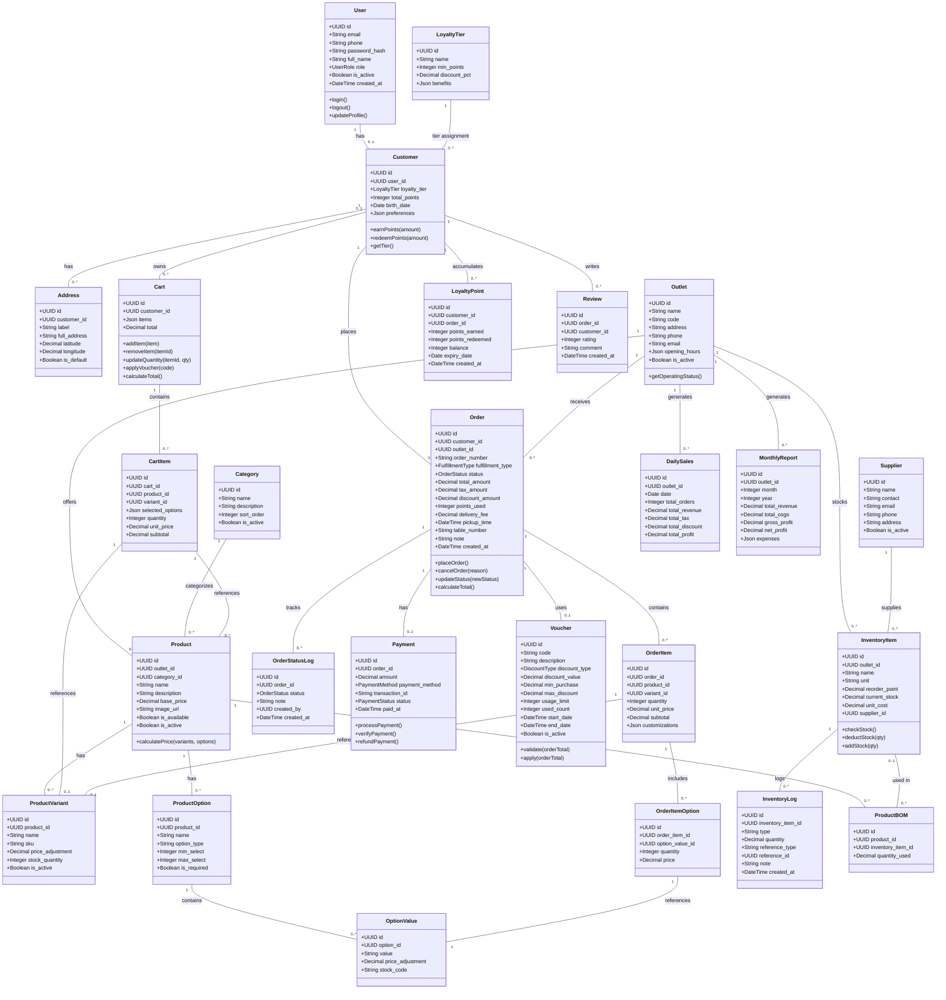

# Class Diagram - CoffeeShop Online

> Pemodelan Berorientasi Objek - Class Diagram

## Penjelasan Relasi Kunci

| Relasi | Makna |
|--------|-------|
| User - Customer | Satu user bisa menjadi satu customer (1:1 opsional). |
| Customer - Order | Satu customer bisa memiliki banyak order. |
| Outlet - Product | Setiap outlet punya katalog produk sendiri (multi-outlet). |
| Product - ProductVariant - OptionValue | Produk memiliki varian (ukuran) dan opsi (susu, gula, topping). |
| Order - OrderItem - OrderItemOption | Struktur hierarkis pesanan. |
| ProductBOM - InventoryItem | Menghubungkan produk dengan bahan baku untuk auto-deduction stok. |
| Order - Payment - OrderStatusLog | Setiap order punya satu pembayaran dan banyak log status. |
| Customer - LoyaltyPoint - LoyaltyTier | Pelacakan poin dan tier loyalitas. |
| Outlet - DailySales/MonthlyReport | Agregat laporan per outlet. |
