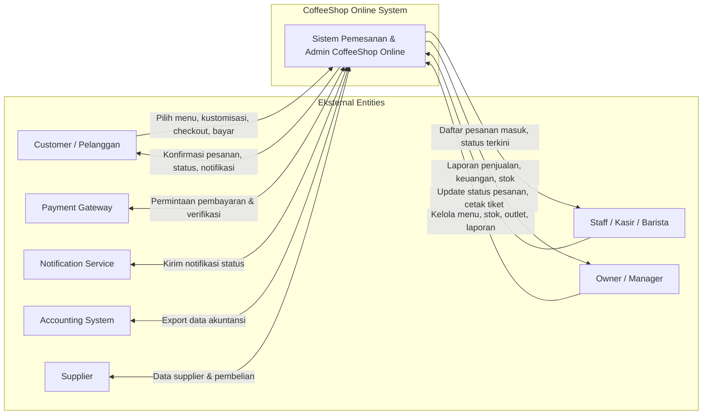

# Data Flow Diagram Level 0 (Context Diagram)

> DFD Level 0 - Gambaran konteks sistem CoffeeShop Online dengan entitas eksternal.

## Daftar Entitas Eksternal

| Entitas | Peran | Data Masuk | Data Keluar |
|---------|-------|------------|-------------|
| Customer | Pelanggan yang memesan | Pesanan, pembayaran, review | Konfirmasi, status, notifikasi, poin |
| Staff | Kasir/Barista | Update status, konfirmasi pesanan | Daftar antrian pesanan |
| Owner/Manager | Pengelola bisnis | Konfigurasi menu, harga, stok, voucher | Laporan penjualan & keuangan |
| Payment Gateway | Pemroses pembayaran | Request pembayaran | Status pembayaran |
| Notification Service | Pengirim notifikasi | Pesan & penerima | Status terkirim |
| Accounting System | Software akuntansi | Data transaksi | Status sinkronisasi |
| Supplier | Penyedia bahan baku | Data pembelian stok | Informasi supplier |

## Alur Data Utama

1. **Customer** mengirimkan pesanan melalui aplikasi/web.
2. **System** memproses pesanan dan mengirimkan permintaan pembayaran ke **Payment Gateway**.
3. **Payment Gateway** mengembalikan status pembayaran.
4. **System** memberi tahu **Customer** dan **Staff** tentang pesanan baru.
5. **Staff** memperbarui status pesanan saat diproses.
6. **System** mengirim notifikasi status melalui **Notification Service**.
7. **Owner/Manager** mengakses laporan dari **System**.
8. **System** mengekspor data akuntansi ke **Accounting System** secara otomatis.

---

*Diagram ini adalah level tertinggi yang menjelaskan interaksi sistem dengan dunia luar.*
