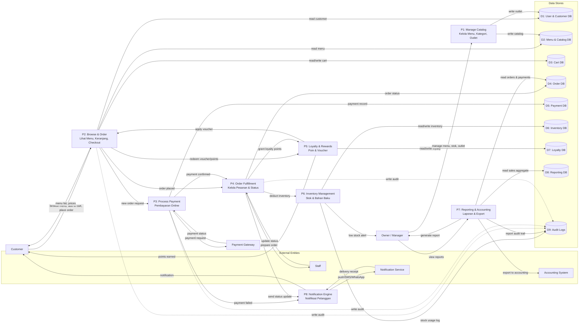

# Data Flow Diagram Level 1

> DFD Level 1 - Dekomposisi Sistem CoffeeShop Online menjadi proses-proses utama.

## Daftar Proses (P)

| ID | Nama Proses | Deskripsi | Input | Output |
|----|-------------|-----------|-------|--------|
| P1 | Manage Catalog | Kelola outlet, kategori, produk, varian, opsi, harga | Data dari Owner/Manager | Menu & catalog terbaru |
| P2 | Browse & Order | Pelanggan melihat menu, membuat pesanan, checkout | Permintaan customer | Order request, cart |
| P3 | Process Payment | Memproses pembayaran melalui gateway | Order total, payment method | Payment status |
| P4 | Order Fulfillment | Mengelola dapur, status pesanan, selesai | Pesanan baru, update staff | Status pesanan, inventory request |
| P5 | Loyalty & Rewards | Mengelola poin, tier, voucher | Order completed, redeem request | Poin, diskon |
| P6 | Inventory Management | Mengelola stok bahan baku, alert, BOM | Penggunaan dari order, input stok | Stok terkini, alert |
| P7 | Reporting & Accounting | Membuat laporan harian/bulanan dan export | Data order & payment | Laporan & export file |
| P8 | Notification Engine | Mengirim notifikasi ke pelanggan | Trigger dari order/payment | Pesan ke notification service |

## Daftar Data Store (D)

| ID | Nama | Isi |
|----|------|-----|
| D1 | User & Customer DB | Users, customers, addresses, staff, roles |
| D2 | Menu & Catalog DB | Outlets, categories, products, variants, options, option values |
| D3 | Cart DB | Cart dan cart items sementara |
| D4 | Order DB | Orders, order items, order status logs |
| D5 | Payment DB | Payments, refunds, transaction logs |
| D6 | Inventory DB | Inventory items, BOM, suppliers, inventory logs |
| D7 | Loyalty DB | Loyalty tiers, loyalty points, vouchers |
| D8 | Reporting DB | Daily sales, monthly reports, analytics |
| D9 | Audit Logs | Semua perubahan status, payment, stok |

## Catatan
- Proses P2 menerima trigger dari customer, tetapi voucher/poin diproses melalui P5.
- Pembayaran P3 adalah boundary dengan payment gateway eksternal.
- Setiap perubahan status pesanan di P4 men-trigger notifikasi P8 dan pengurangan stok P6.
- Laporan P7 membaca data agregat dari D8 agar query cepat.
