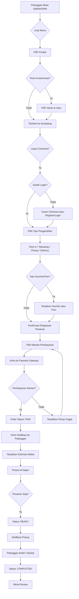
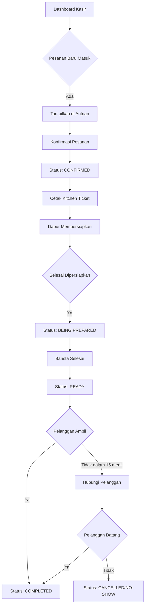
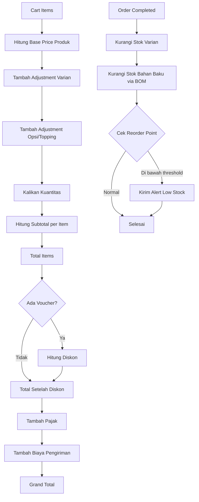
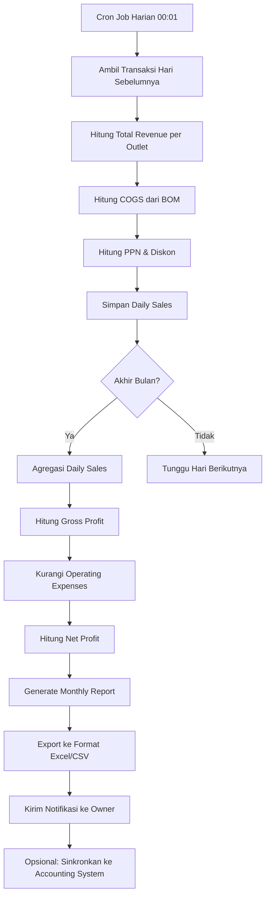
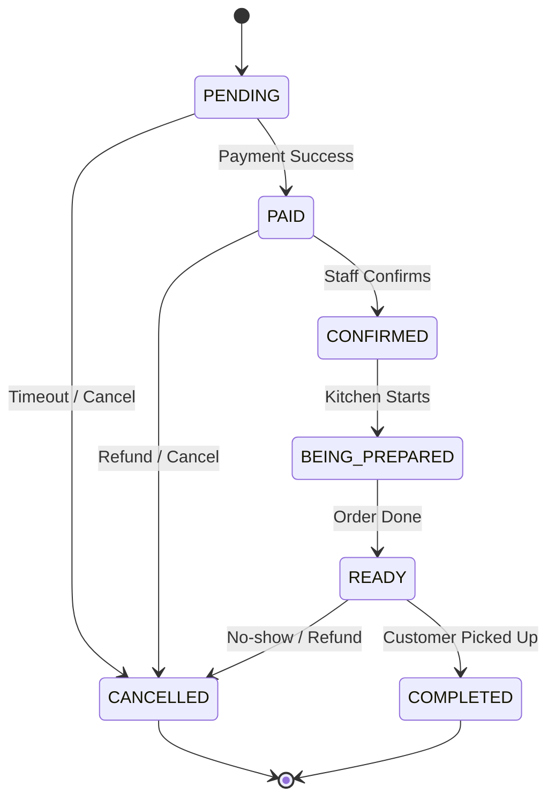
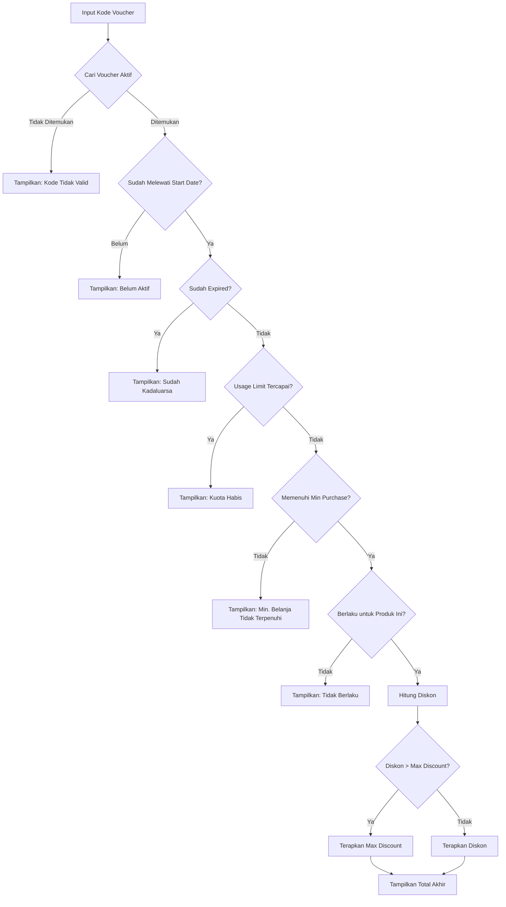
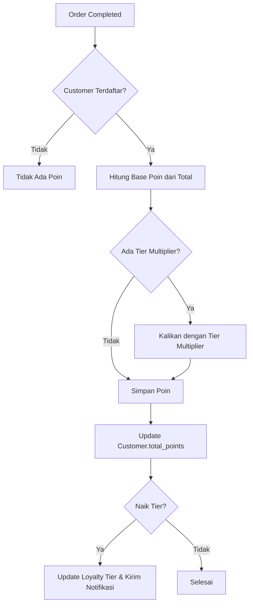

# Process Flow Diagram - CoffeeShop Online

> Pemodelan Aliran Proses & Logika Bisnis

## 1. Alur Proses Pemesanan Online (Customer)

## 2. Alur Proses Back Office - Manajemen Pesanan

## 3. Alur Proses Perhitungan Harga & Stok

## 4. Alur Proses Laporan Bulanan Otomatis

## 5. Logika Status Pesanan

| Status | Keterangan | Aktor Trigger |
|--------|------------|---------------|
| PENDING | Pesanan dibuat, menunggu pembayaran | System |
| PAID | Pembayaran berhasil | Payment Gateway |
| CONFIRMED | Kasir mengonfirmasi pesanan | Staff |
| BEING_PREPARED | Sedang dipersiapkan di dapur | Staff |
| READY | Pesanan siap diambil | Staff |
| COMPLETED | Pesanan selesai diambil | Staff/Customer |
| CANCELLED | Pesanan dibatalkan | Staff/System |

## 6. Logika Penerapan Voucher

## 7. Logika Loyalty Points

