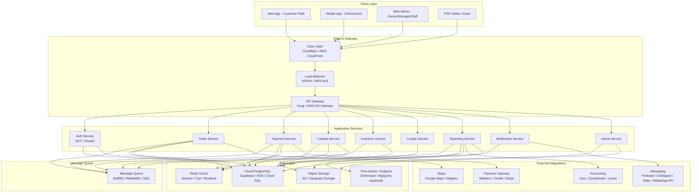

# System Architecture - CoffeeShop Online

> Arsitektur cloud database dan sistem end-to-end untuk platform pesanan online coffeeshop.

## Penjelasan Komponen

| Layer | Komponen | Fungsi |
|-------|----------|--------|
| Client | Web App PWA | Pelanggan memesan via browser, bisa di-install seperti app. |
| Client | Mobile App | Aplikasi native iOS/Android untuk loyalitas & push notif. |
| Client | Web Admin | Dashboard owner, manager, kasir untuk kelola bisnis. |
| Client | POS Tablet/Kiosk | Antarmuka kasir dan self-service kiosk di outlet. |
| Edge | CDN/WAF | Distribusi konten, caching, proteksi DDoS. |
| Edge | Load Balancer | Distribusi traffic ke API services. |
| Edge | API Gateway | Routing, rate limiting, autentikasi, logging. |
| Service | Auth Service | Login, register, JWT, role-based access. |
| Service | Order Service | Pemesanan, status, fulfillment. |
| Service | Payment Service | Integrasi payment gateway dan refund. |
| Service | Catalog Service | Menu, kategori, produk, varian, opsi, harga. |
| Service | Inventory Service | Stok bahan baku, BOM, alert. |
| Service | Loyalty Service | Poin, tier, voucher. |
| Service | Reporting Service | Agregasi laporan dan export akuntansi. |
| Service | Notification Service | Push, SMS, WhatsApp, email. |
| Data | PostgreSQL | Database utama transaksional. |
| Data | Redis | Cache, session, cart real-time. |
| Data | Object Storage | Foto produk, struk, laporan. |
| Data | Message Queue | Webhook async, notifikasi, reporting job. |
| External | Payment Gateway | Midtrans, Xendit, Stripe, dll. |
| External | Accounting | Xero, QuickBooks, Jurnal.id. |
| External | Messaging | Firebase Cloud Messaging, OneSignal, Twilio. |

## Skalabilitas
- **Horizontal**: Service dapat di-scale independent (Order Service tinggi saat promo).
- **Database**: Gunakan read replicas untuk laporan; sharding jika outlet sangat banyak.
- **Cache**: Redis untuk hot data (menu aktif, session).
- **CDN**: Static asset dan gambar produk di-cache global.

## Keamanan
- TLS 1.3 untuk semua komunikasi.
- JWT dengan refresh token rotation.
- RBAC per role.
- Input validation & SQL injection prevention via ORM.
- Rate limiting di API Gateway.
- Database encryption at rest.
- Backup otomatis harian dan point-in-time recovery.

## Alur Data Sederhana
1. Customer buka Web App → CDN → API Gateway → Catalog Service → PostgreSQL/Redis.
2. Customer checkout → Order Service → Payment Service → Payment Gateway.
3. Payment sukses → Webhook masuk Queue → Notification Service mengirim notifikasi.
4. Staff update status → Order Service → Inventory Service mengurangi stok → Redis publish real-time status.
5. Tengah malam → Reporting Service mengagregasi daily_sales dan monthly_reports.
