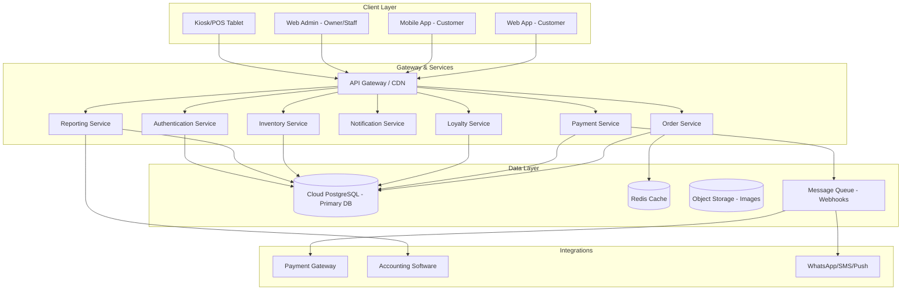

# CoffeeShop Online - Product Requirements & Planning Document

## 1. Visi & Tujuan

### 1.1 Visi Produk
Membuat platform digital end-to-end untuk coffeeshop agar pelanggan dapat memesan kopi, makanan, dan merchandise secara online dengan cepat dan nyaman, sementara pemilik mendapatkan otomatisasi administrasi bulanan yang akurat.

### 1.2 Tujuan Bisnis
| No | Tujuan | Indikator Keberhasilan |
|----|--------|------------------------|
| 1 | Meningkatkan jumlah pesanan harian | +30% transaksi dalam 3 bulan pertama |
| 2 | Mengurangi antrean di kasir | Waktu tunggu rata-rata turun 25% |
| 3 | Otomatisasi laporan keuangan bulanan | Laporan P&L, stok, dan pajak tersedia otomatis per tanggal 5 bulan berikutnya |
| 4 | Meningkatkan retensi pelanggan | 25% pelanggan aktif menggunakan loyalty program dalam 6 bulan |
| 5 | Efisiensi operasional | Pengurangan 50% waktu manual input data penjualan ke spreadsheet |

### 1.3 Target Pengguna
- **Pelanggan (Customer)**: Usia 18-45 tahun, pengguna smartphone, menghargai kemudahan dan kecepatan.
- **Kasir/Barista (Staff)**: Butuh antarmuka sederhana untuk konfirmasi pesanan dan pengelolaan outlet.
- **Manajer/Owner**: Butuh dashboard analytics, laporan otomatis, dan kontrol harga/menu.
- **Admin/Keuangan**: Butuh data export untuk akuntansi dan pajak.

---

## 2. Fitur-Fitur yang Dibutuhkan

### 2.1 Fitur Pelanggan (Customer-Facing)

#### F-001: Menu Digital & Pencarian
- **Deskripsi**: Tampilan menu dengan foto, deskripsi, harga, kategori, dan tag (vegan, gluten-free, bestseller, dll).
- **Detail**:
  - Filter berdasarkan kategori (Hot Coffee, Cold Coffee, Non-Coffee, Food, Merchandise).
  - Pencarian real-time dengan autocomplete.
  - Badge "Sedang Tren" atau "Best Seller".
  - Informasi nutrisi dan alergen (opsional).
- **Acceptance Criteria**:
  - [ ] Pelanggan dapat menemukan produk dalam ≤ 3 ketukan.
  - [ ] Filter dan pencarian bekerja dalam < 1 detik untuk katalog < 500 item.

#### F-002: Kustomisasi Pesanan
- **Deskripsi**: Pelanggan dapat menyesuaikan minuman sesuai preferensi.
- **Detail**:
  - Ukuran (Small/Medium/Large).
  - Jenis susu (Full Cream, Oat, Almond, Soy).
  - Tingkat gula/es/sirup.
  - Tambahan topping (es krim, extra shot, whip cream).
  - Catatan khusus untuk barista.
- **Acceptance Criteria**:
  - [ ] Setiap kustomisasi menghitung harga tambahan secara real-time.
  - [ ] Kombinasi yang tidak tersedia ditampilkan dengan pesan jelas.

#### F-003: Keranjang & Checkout
- **Deskripsi**: Alur keranjang yang cepat dengan opsi checkout sebagai tamu atau login.
- **Detail**:
  - Edit kuantitas dan hapus item di keranjang.
  - Guest checkout tanpa registrasi wajib.
  - Pilih metode pengambilan: Dine-in, Takeaway, Delivery, Pickup.
  - Pilih waktu pickup/scheduled order.
  - Penerapan voucher, diskon, dan poin loyalty.
- **Acceptance Criteria**:
  - [ ] Checkout selesai dalam maksimal 5 langkah dari keranjang.
  - [ ] Sistem menyimpan keranjang jika user meninggalkan aplikasi.

#### F-004: Pembayaran Online
- **Deskripsi**: Integrasi dengan payment gateway lokal dan internasional.
- **Detail**:
  - QRIS (untuk pasar Indonesia).
  - E-wallet (GoPay, OVO, DANA, LinkAja, ShopeePay).
  - Virtual Account (BCA, BNI, Mandiri, BRI, Permata).
  - Credit/Debit Card (Visa/Master/JCB).
  - Apple Pay / Google Pay (untuk pasar internasional).
  - Cash on Delivery/Pickup (opsional).
- **Acceptance Criteria**:
  - [ ] Pembayaran diproses dalam < 10 detik.
  - [ ] Notifikasi pembayaran sukses/gagal dikirim real-time.

#### F-005: Pelacakan Pesanan (Order Tracking)
- **Deskripsi**: Pelanggan dapat melihat status pesanan secara real-time.
- **Detail**:
  - Status: Pending → Paid → Confirmed → Being Prepared → Ready → Completed/Cancelled.
  - Estimasi waktu siap.
  - Notifikasi push/SMS/WhatsApp saat status berubah.
- **Acceptance Criteria**:
  - [ ] Status diperbarui dalam < 5 detik setelah perubahan di POS.

#### F-006: Riwayat Pesanan & Reorder
- **Deskripsi**: Akses riwayat dan pesan ulang dengan satu klik.
- **Acceptance Criteria**:
  - [ ] Riwayat tersedia 12 bulan terakhir.
  - [ ] Reorder memuat ulang semua kustomisasi sebelumnya.

#### F-007: Loyalty & Rewards
- **Deskripsi**: Program loyalitas berbasis poin dan tier.
- **Detail**:
  - 1 poin per Rp 10.000 (atau konfigurasi owner).
  - Redeem poin menjadi diskon/voucher.
  - Birthday reward.
  - Tier (Bronze, Silver, Gold, Platinum) dengan benefit berbeda.
- **Acceptance Criteria**:
  - [ ] Poin otomatis terhitung setelah transaksi berhasil.
  - [ ] Notifikasi saat mencapai tier baru.

#### F-008: Reservasi Meja (Opsional)
- **Deskripsi**: Pelanggan dapat memesan meja untuk dine-in.
- **Acceptance Criteria**:
  - [ ] Sistem menampilkan ketersediaan meja real-time.

---

### 2.2 Fitur Manajemen Toko (Back Office)

#### F-009: Manajemen Menu
- **Deskripsi**: CRUD produk, kategori, varian, topping, dan harga.
- **Detail**:
  - Pengaturan stok per varian.
  - Harga dinamis (happy hour, promo).
  - Foto produk dan deskripsi.
  - Toggle visibility produk.
- **Acceptance Criteria**:
  - [ ] Perubahan harga/menu terefleksi di aplikasi customer dalam < 1 menit.

#### F-010: Manajemen Outlet
- **Deskripsi**: Multi-outlet support dengan jam operasional dan alamat masing-masing.
- **Acceptance Criteria**:
  - [ ] Owner dapat menambahkan outlet baru dalam 5 menit.

#### F-011: Manajemen Pesanan (Order Management)
- **Deskripsi**: Dashboard untuk kasir/barista menerima dan memperbarui status pesanan.
- **Detail**:
  - Tampilan antrian pesanan real-time.
  - Filter berdasarkan channel (online, in-store, third-party).
  - Print struk/kitchen ticket.
  - Cancel/refund dengan alasan.
- **Acceptance Criteria**:
  - [ ] Pesanan baru muncul di dashboard dalam < 3 detik.

#### F-012: Manajemen Stok & Bahan Baku
- **Deskripsi**: Pelacakan stok bahan baku dan auto-deduction saat penjualan.
- **Detail**:
  - BOM (Bill of Materials) per produk.
  - Low-stock alert.
  - Supplier management.
- **Acceptance Criteria**:
  - [ ] Stok berkurang otomatis setelah pesanan completed.
  - [ ] Alert dikirim saat stok di bawah reorder point.

#### F-013: Manajemen Karyawan & Role
- **Deskripsi**: Hak akses berbasis peran.
- **Role**: Owner, Manager, Kasir, Barista, Finance/Admin.
- **Acceptance Criteria**:
  - [ ] Setiap role hanya mengakses fitur yang diizinkan.

---

### 2.3 Fitur Administrasi & Akuntansi Otomatis

#### F-014: Laporan Penjualan Harian/Bulanan
- **Deskripsi**: Dashboard penjualan dengan filter periode, outlet, dan kategori.
- **Acceptance Criteria**:
  - [ ] Laporan otomatis tersedia setiap hari pukul 00:01.

#### F-015: Laporan Keuangan Otomatis
- **Deskripsi**: P&L sederhana, arus kas, dan neraca sederhana.
- **Detail**:
  - Pendapatan per kategori produk.
  - COGS (Cost of Goods Sold) otomatis dari BOM dan harga beli bahan.
  - Biaya operasional (input manual).
  - Laba kotor dan laba bersih.
- **Acceptance Criteria**:
  - [ ] Laporan bulanan tersedia otomatis tanggal 1 bulan berikutnya.

#### F-016: Export Data Akuntansi
- **Deskripsi**: Export ke Excel/CSV atau integrasi dengan Xero/QuickBooks.
- **Acceptance Criteria**:
  - [ ] Export jurnal umum, buku besar, dan buku kas tersedia.

#### F-017: Laporan Pajak
- **Deskripsi**: Ringkasan pajak pertambahan nilai (PPN) yang terkumpul.
- **Acceptance Criteria**:
  - [ ] Laporan pajak per periode dapat diekspor untuk pelaporan SPT.

---

### 2.4 Fitur Marketing & CRM

#### F-018: Voucher & Promo
- **Deskripsi**: Kode voucher, diskon persentase/nominal, buy X get Y.
- **Acceptance Criteria**:
  - [ ] Voucher dapat dibatasi per produk, kategori, atau user.

#### F-019: Push Notification
- **Deskripsi**: Notifikasi promo, status pesanan, dan reminder.
- **Acceptance Criteria**:
  - [ ] Notifikasi diterima dalam < 5 detik.

#### F-020: Review & Rating
- **Deskripsi**: Pelanggan dapat memberikan rating dan ulasan.
- **Acceptance Criteria**:
  - [ ] Review hanya dapat diberikan setelah pesanan selesai.

---

## 3. Analisis Web/Aplikasi Coffee Shop dengan UX Terbaik

### 3.1 Benchmark Aplikasi Coffee Shop (Rating App Store US)

| Aplikasi | Rating | Review Count | Keunggulan UX |
|----------|--------|--------------|---------------|
| **7 Brew Coffee** | 4.96 | 108.609 | UI bersih, pemesanan cepat, loyalty intuitif |
| **Dutch Bros** | 4.93 | 865.415 | Loyalty & rewards sangat menarik, scan-to-pay |
| **Chick-fil-A** | 4.93 | 4.249.395 | Checkout cepat, saved favorite, curbside smooth |
| **Blank Street** | 4.90 | 11.220 | Menu minimalis, pre-order sederhana |
| **Starbucks** | 4.89 | 8.371.194 | Mobile order & pay, reward integration, store locator |
| **Peet's Coffee** | 4.88 | 215.023 | Navigasi menu jelas, saved orders |
| **Panera Bread** | 4.91 | 1.275.432 | Subscription loyalty, rapid reorder |
| **Sonic Drive-In** | 4.86 | 2.639.649 | Pickup time yang jelas, reward integration |

### 3.2 Kesimpulan Benchmark
Aplikasi dengan **rating tertinggi** memiliki pola UX umum:
1. **Onboarding singkat**: Login opsional, guest checkout tersedia.
2. **Reorder cepat**: Tombol "Order Again" di halaman home.
3. **Menu visual**: Foto besar, kategori jelas, badge best seller.
4. **Kustomisasi satu layar**: Pilihan varian dalam modal/bottom sheet.
5. **Checkout tanpa gesekan**: Saved payment, Apple Pay/Google Pay, minimal form.
6. **Loyalty terintegrasi**: Poin terlihat di setiap layar.
7. **Status transparan**: Real-time order tracking dengan notifikasi.
8. **Personalization**: Rekomendasi berdasarkan riwayat pesanan.

### 3.3 Best Practices UX yang Harus Diadopsi
Berdasarkan riset **Baymard Institute** dan **Nielsen Norman Group**:
- **Guest Checkout** harus menjadi opsi paling menonjol (62% situs masih salah).
- **Password creation** jangan terlalu ketat (bisa menyebabkan 19% abandonment).
- **Fulfillment options** (pickup, delivery, dine-in) tampil di selector yang sama.
- **Required & optional fields** ditandai eksplisit.
- **Avoid "Apply" buttons** untuk mengubah kuantitas.
- **One-page checkout** lebih baik daripada multi-step.
- **Saved payment methods** mengurangi gesekan berulang.
- **Progress indicator** saat checkout.

---

## 4. Persona & User Journey

### 4.1 Persona: "Maya, 28 tahun, Freelancer"
- Memesan kopi saat meeting online.
- Menginginkan: pesan cepat, bayar QRIS, ambil tanpa antre.
- Pain point: aplikasi berat, menu berantakan, login ribet.

### 4.2 Persona: "Budi, 35 tahun, Owner"
- Ingin tahu penjualan harian tanpa buka spreadsheet.
- Butuh: laporan otomatis, pantau stok, lihat produk terlaris.
- Pain point: data manual sering salah, tidak tahu margin laba.

### 4.3 User Journey Pelanggan
```
Buka App → Lihat Home/Rekomendasi → Pilih Menu → Kustomisasi → Tambah Keranjang → Pilih Pickup/Waktu → Checkout & Bayar → Terima Notifikasi → Ambil Pesanan → Review
```

### 4.4 User Journey Owner
```
Login Dashboard → Lihat Ringkasan Penjualan → Cek Stok → Update Menu (jika perlu) → Tutup Hari → Lihat Laporan Harian → Akhir Bulan: Export Laporan Keuangan/Pajak
```

---

## 5. Arsitektur Sistem (Ringkasan)

### 5.1 High-Level Architecture


### 5.2 Cloud Database Choice
- **Primary Database**: PostgreSQL (relasional, ACID-compliant, cocok untuk transaksi dan reporting).
- **Cloud Provider Options**:
  - **Supabase** (PostgreSQL managed + realtime + auth + storage) — cepat dan cost-effective untuk MVP.
  - **Firebase** (NoSQL Firestore) — baik untuk real-time tetapi kurang ideal untuk laporan akuntansi.
  - **AWS RDS / Google Cloud SQL / Azure Database for PostgreSQL** — untuk skala enterprise.
- **Rekomendasi**: **Supabase** untuk MVP/small-medium; **AWS RDS PostgreSQL** untuk scale-up enterprise.

### 5.3 Skalabilitas & Keamanan
- Semua API menggunakan HTTPS/TLS.
- JWT-based authentication dengan refresh token.
- Role-based access control (RBAC).
- Database encryption at rest.
- Rate limiting dan input validation.
- Backup otomatis harian.

---

## 6. Roadmap & Prioritas

### Phase 1: MVP (Bulan 1-2)
- Menu digital + kustomisasi
- Cart + checkout + QRIS/payment gateway
- Order management dashboard untuk kasir
- Laporan penjualan harian sederhana

### Phase 2: Growth (Bulan 3-4)
- Loyalty & rewards
- Push notification
- Multi-outlet support
- Inventory tracking dasar

### Phase 3: Scale (Bulan 5-6)
- Advanced reporting & accounting export
- Reservasi meja
- Marketing/promo automation
- Analytics & forecasting

---

## 7. Acceptance Criteria Keseluruhan
- [ ] Pelanggan dapat memesan dalam < 90 detik dari buka aplikasi.
- [ ] Owner mendapat laporan penjualan harian otomatis.
- [ ] Laporan keuangan bulanan otomatis tersedia per tanggal 1.
- [ ] Sistem uptime > 99.5%.
- [ ] Data pembayaran memenuhi standar PCI-DSS (via payment gateway).

---

## 8. Risiko & Mitigasi

| Risiko | Dampak | Mitigasi |
|--------|--------|----------|
| Payment gateway gagal/tidak stabil | Tinggi | Fallback ke multi gateway (Midtrans + Xendit) |
| Stok tidak sinkron dengan online order | Tinggi | Real-time stock deduction + lock saat checkout |
| User tidak mau download app | Sedang | Sediakan web-based PWA |
| Data akuntansi tidak akurat | Tinggi | Validasi transaksi + audit log |
| Kecepatan loading aplikasi lambat | Sedang | CDN, caching, lazy loading image |

---

## 9. Pertanyaan Terbuka untuk Client
1. Apakah coffeeshop memiliki satu outlet atau multi-outlet sejak awal?
2. Apakah ingin delivery sendiri atau hanya pickup/dine-in?
3. Payment gateway apa yang sudah terdaftar/ingin dipakai (Midtrans/Xendit/dll)?
4. Apakah sudah menggunakan software akuntansi seperti Xero/QuickBooks/Jurnal?
5. Berapa jumlah SKU/menu yang akan dijual online?
6. Apakah ada program loyalty yang sudah berjalan?
7. Apakah perlu integrasi dengan printer kasir/kitchen?

---

*Dokumen ini disusun sebagai dasar pembuatan PRD di session baru.*
